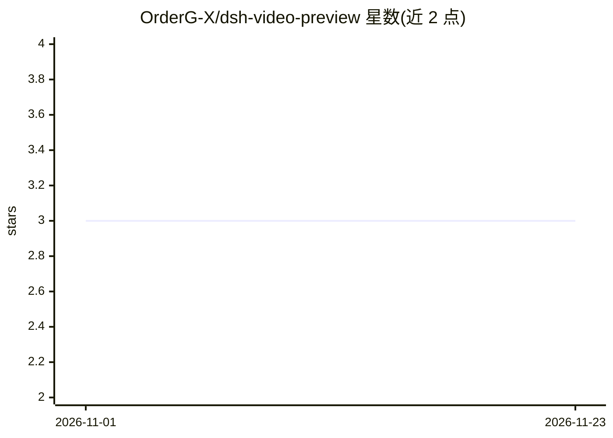

# OrderG-X/dsh-video-preview

⭐ 3 · JavaScript · MIT · 推送 2026-11-12 · [GitHub](https://github.com/OrderG-X/dsh-video-preview) · 个人维护 · 中文 README

**给 DSH 对话加内联视频/音频播放的插件**

DeepSeek Harness（DSH）的插件，补上 DSH 渲染块缺失的 video 类型：模型生成的媒体文件在回合结束时自动在回复下方挂载播放器，也可通过 play_video 工具播放指定本地文件，支持 Range 流式播放与侧边栏大屏预览。look_video 工具用无头 Chrome/Edge 截帧拼图并检测静音、黑屏、编码兼容性，把结果交给模型自查。通过 DSH 插件页填 npm 包名安装，需重启 DSH；v0.3.0 前版本存在 cookie 伪造漏洞，README 建议升级。

## 筛选速览

| 维度 | 判定 | 备注 |
|---|---|---|
| AI 角色 | `ai-ecosystem` | LLM/agent 周边工具 |
| 许可风险 | `permissive` | MIT |
| 部署形态 | `None` |  |
| 模型依赖 | locked-api |  |
| 硬件要求 | — | 无带数字的原话,不猜 |
| 安装摩擦 | `medium` | 含编译或系统依赖之一 |
| 成熟度 | — | 结构信号不足 |

## 能力要点

- 回合结束自动为模型新生成的媒体文件挂播放器，无需模型调工具
- look_video 截帧拼图交给模型，并检测静音/黑屏/爆音/手机兼容性
- 两条播放路由自带媒体白名单、防 DNS 重绑定与 HMAC 签名地址
- 播放出错时给出原因诊断与 ffmpeg 转码命令

## 适用场景

- 模型录屏、转码、配音生成文件后直接在对话里观看
- 让模型自查生成的视频有无黑屏、无声等质量问题
- 播放 DSH 原生标记为不可预览的 mp4 文件

## 场景标签

 · 领域:LLM 客户端工具/插件

## 证据(README 行号)

> L16: > **一句话**：DeepSeek Harness（DSH）插件，在对话里直接播放本地视频和音频。模型录屏、转码、配音做出来的文件，播放器自动出现在回复下面；别的文件用 `play_video` 工具播；模型用 `look_vi
> L46: DSH 的消息渲染块只有 text / image / file / table，**没有 video**，工具调用块又默认折叠。这个插件用纯官方插件 API 补上内联播放（零 `@deepseek-ai/*` 依赖，和官方 `p
> L20: > **安装**：DSH「插件」页 →「添加插件」，填 `@orderg-x/dsh-video-preview`（npm 包，连不上 npm 会自动换国内镜像），重启 DSH。

## 星数曲线

2026-11-01 3 → 2026-11-23 3（+0）

---
*卡片 v1 · prompt 1.4 · 生成 2026-11-22 · 置信度 high · 依据 README sha `c6454f8e41b8` · [字段定义](../../DATASET.md)*
