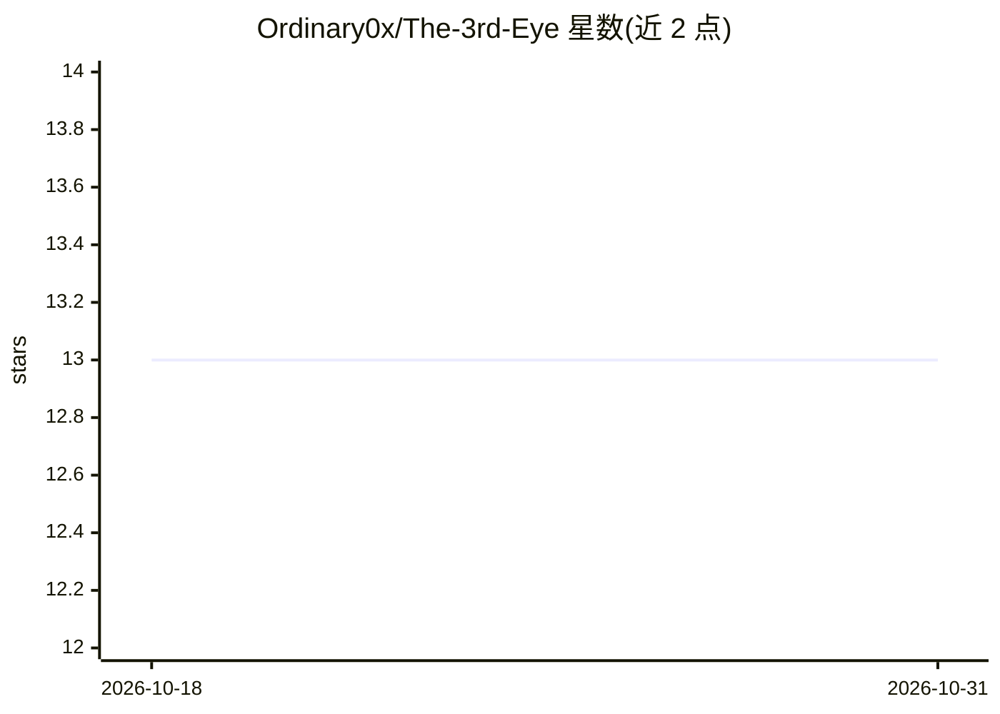

# Ordinary0x/The-3rd-Eye

⭐ 13 · Python · MIT · 推送 2025-12-17 · [GitHub](https://github.com/Ordinary0x/The-3rd-Eye) · 个人维护

**基于 Agent 图架构的 OSINT 框架：自动收集分析公开信息并生成情报报告**

模块化开源情报（OSINT）Agentic 框架，采用 LangGraph 图式 Agent 架构编排搜索 Agent、URL 分类、各平台爬虫（LinkedIn/Instagram/Twitter/Facebook）、用户名枚举（Maigret）与邮箱分析模块，使用 Google Gemini 2.5 做情报综合，输出固定结构的 Markdown 情报报告（含执行摘要、位置情报、暴露与风险评估）。需要 GOOGLE_API_KEY，HIBP/BreachDirectory/IntelX 为可选增强。定位教育、研究与防御性 OSINT 用途；电话情报、Maigret 全自动化仍在开发中，Ollama 本地模型支持列于未来计划。

## 筛选速览

| 维度 | 判定 | 备注 |
|---|---|---|
| AI 角色 | `ai-native` | 本体是模型或模型工具 |
| 许可风险 | `permissive` | MIT |
| 部署形态 | `library` | 以包/库形式分发 |
| 模型依赖 | — | README 未给出锁定关系 |
| 硬件要求 | — | 无带数字的原话,不猜 |
| 安装摩擦 | `low` | 无编译、无系统依赖或容器化 |
| 成熟度 | — | 结构信号不足 |

## 能力要点

- LangGraph 图式多 Agent 架构（搜索/分类/爬取/分析/报告综合）
- 集成 Maigret、Holehe、Instaloader、twscrape 等既有 OSINT 工具
- 跨平台身份关联与用户名枚举
- 生成固定结构 Markdown 情报报告（PDF 可选）

## 适用场景

- 调查目标在公开网络上的数字足迹与跨平台身份关联
- 发现暴露的联系方式与数据泄露关联
- 生成面向分析人员的结构化 OSINT 情报报告

## 场景标签

`Agent 框架` `多智能体` `网页抓取` `网络安全` · 领域:Agent 开发

## 证据(README 行号)

> L3: **The 3rd Eye** is a modular Open Source Intelligence (OSINT) Agentic framework designed to collect, correlate, and 
> L62: The project follows a **graph-based agent architecture** using LangGraph.
> L111: * **Google Gemini 2.5** (intelligence synthesis)

## 星数曲线

2026-10-18 13 → 2026-10-31 13（+0）

---
*卡片 v1 · prompt 1.4 · 生成 2026-10-31 · 置信度 mid · 依据 README sha `ee8a76fe201c` · [字段定义](../../DATASET.md)*
