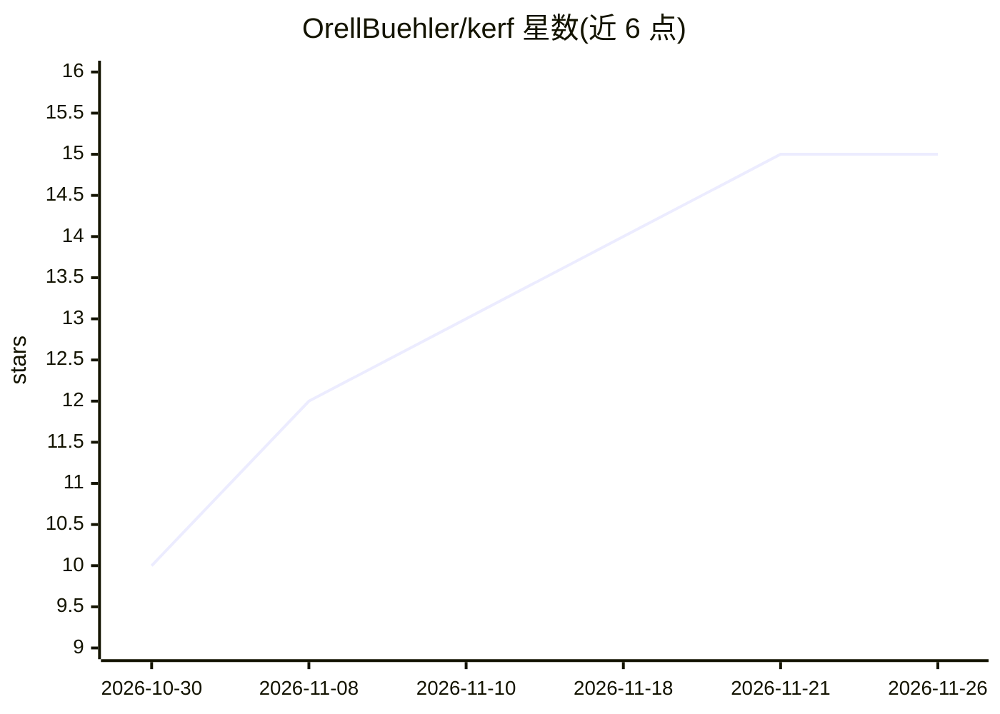

# OrellBuehler/kerf

⭐ 15 · Rust · NOASSERTION · 推送 2026-11-25 · [GitHub](https://github.com/OrellBuehler/kerf) · [官网](https://orellbuehler.github.io/kerf/) · 个人维护

**内嵌 MCP 服务器的跨平台非破坏性视频编辑器，供 LLM 驱动剪辑**

基于 Rust/Tauri/Svelte 的桌面非线性编辑器：时间线为原始媒体上的编辑列表（EDL），导出前不重编码。核心机制是内嵌 MCP 服务器（streamable HTTP，本机 7777 端口，bearer token 鉴权），MCP 客户端与 GUI 共享同一项目引擎，agent 可通过 get_frame/skim_asset 等工具读取真实帧图像并提交待审阅的剪辑提案（diff + 可撤销修订）。支持多轨 NLE、播放、转码导出（NVENC/QSV/VideoToolbox/AMF）、whisper 转写、节拍吸附、360 重取景、SRT 字幕等；提供安装包与源码构建，支持 headless 运行 MCP 服务器。

## 筛选速览

| 维度 | 判定 | 备注 |
|---|---|---|
| AI 角色 | `ai-enhanced` | 去掉 AI 部分产品仍成立 |
| 许可风险 | `none` | NOASSERTION |
| 部署形态 | `desktop` | 安装包/桌面程序 |
| 模型依赖 | — | README 未给出锁定关系 |
| 硬件要求 | — | 无带数字的原话,不猜 |
| 安装摩擦 | `high` | 编译与系统依赖俱全 |
| 成熟度 | — | 结构信号不足 |

## 能力要点

- 内嵌 MCP 服务器，agent 与 GUI 驱动同一引擎和项目
- agent 剪辑以提案形式暂存，带 diff 审阅与可撤销历史
- get_frame/skim_asset 等工具返回真实图像供模型查看
- whisper 转写与语音检测内置于每个构建（FFmpeg whisper filter 或 whisper.cpp）

## 适用场景

- 用 Claude 等 MCP 客户端根据转写文本粗剪素材
- 为 Reels/Shorts/TikTok 等平台检查并导出竖版/方形视频
- 在无显示器的服务器/CI 上以 headless 模式运行 MCP 剪辑服务

## 场景标签

`语音识别` `图像视频处理` · 领域:感知与多模态

## 证据(README 行号)

> L7: Kerf is a cross-platform desktop editor with an **embedded MCP server**, so an LLM
> L27: Plenty of tools bolt a chatbot onto a video editor. Kerf inverts that: the editor **is**
> L104: The desktop app hosts the MCP server over streamable HTTP at `127.0.0.1:7777/mcp`

## 星数曲线

2026-10-30 10 → 2026-11-26 15（+5）

---
*卡片 v1 · prompt 1.4 · 生成 2026-11-18 · 置信度 high · 依据 README sha `9d0f400ca4c8` · [字段定义](../../DATASET.md)*
