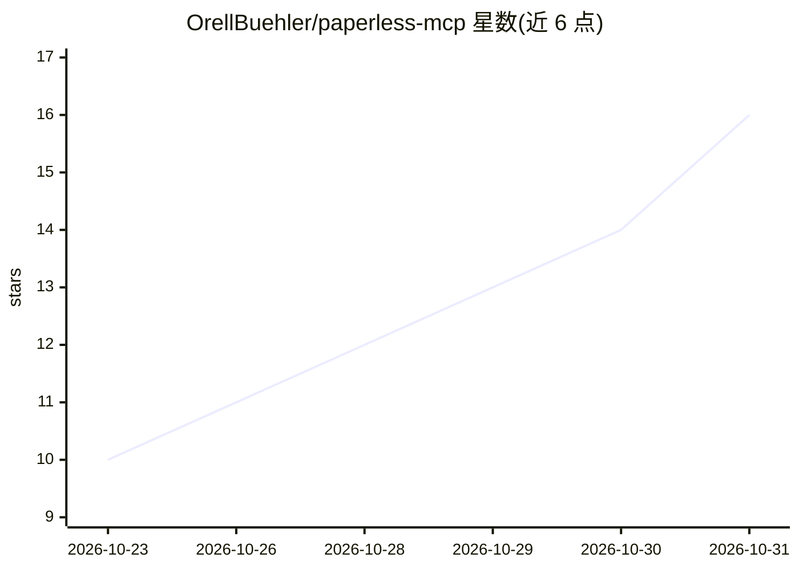

# OrellBuehler/paperless-mcp

⭐ 16 · TypeScript · MIT · 推送 2026-10-22 · [GitHub](https://github.com/OrellBuehler/paperless-mcp) · [官网](https://www.npmjs.com/package/@orellbuehler/paperless-mcp) · 个人维护

**把 Paperless-ngx 暴露给 AI agent 的 MCP 服务器（115+ 工具）**

面向 Paperless-ngx 文档管理系统的 Model Context Protocol 服务器：将 Paperless-ngx REST API 封装为 115+ 个 MCP 工具，供 Claude Code、Claude Desktop 等 MCP 客户端的 AI 助手调用，覆盖文档搜索/上传/批量编辑、标签/联系人/文档类型管理、邮件规则、分享链接、回收站及 3.0 版的版本与 PDF 编辑端点。可选开启语义搜索：用 OpenAI 或 Ollama 生成向量嵌入，存于本地 sqlite-vec，无需外部向量数据库；嵌入功能依赖原生模块，需平台具备构建工具链。支持 stdio 单用户与 HTTP 多用户两种传输，默认固定 API v9 以兼容 2.x 与 3.x。

## 筛选速览

| 维度 | 判定 | 备注 |
|---|---|---|
| AI 角色 | `ai-ecosystem` | LLM/agent 周边工具 |
| 许可风险 | `permissive` | MIT |
| 部署形态 | `self-host` | docker 或自建部署 |
| 模型依赖 | local-ok | 支持本地模型 |
| 硬件要求 | — | 无带数字的原话,不猜 |
| 安装摩擦 | `low` | 无编译、无系统依赖或容器化 |
| 成熟度 | — | 结构信号不足 |

## 能力要点

- 将 Paperless-ngx REST API 封装为 115+ 个 MCP 工具
- 可选语义搜索：OpenAI/Ollama 嵌入存储在本地 sqlite-vec，无需外部向量库
- stdio 单用户与 HTTP 多用户（每人独立 token）两种传输模式
- 默认固定 REST API v9，兼容 Paperless-ngx 2.x 与 3.x

## 适用场景

- 让 Claude 等 AI 助手搜索、上传、打标签并整理我的 Paperless 文档库
- 用语义搜索按含义而非关键词查找归档文档
- 自动分类收件箱文档并按内容批量打标签

## 场景标签

`语义搜索` · 领域:知识与检索

## 证据(README 行号)

> L8: Connect AI agents to Paperless-ngx. This Model Context Protocol server exposes the Paperless-ngx REST API as 115+ to
> L10: Works with any MCP client: Claude Code, Claude Desktop, or your own agent.

## 星数曲线

2026-10-23 10 → 2026-10-31 16（+6）

---
*卡片 v1 · prompt 1.4 · 生成 2026-10-30 · 置信度 high · 依据 README sha `c8890ed2fed0` · [字段定义](../../DATASET.md)*
