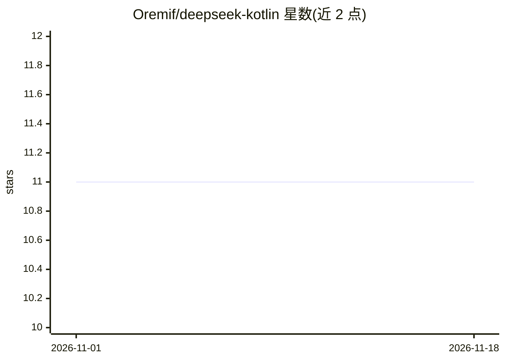

# Oremif/deepseek-kotlin

⭐ 11 · Kotlin · Apache-2.0 · 推送 2026-11-02 · [GitHub](https://github.com/Oremif/deepseek-kotlin) · [官网](https://oremif.github.io/deepseek-kotlin/) · 个人维护

**面向 Kotlin 开发者的 DeepSeek REST API 多平台 SDK**

基于 Ktor 构建的 Kotlin Multiplatform SDK，封装 DeepSeek REST API：覆盖 Chat（思考/非思考模式）、Responses、Files、Fill-In-the-Middle、模型列表与用户余额等端点，支持图片输入、工具调用、JSON 输出、SSE 流式响应与 20 种事件类型。所有端点为 suspend 函数，流式返回 Flow，带类型化异常、指数退避自动重试与可配置超时。需持有 DeepSeek API key，支持 JVM/Android/iOS/macOS/Linux/Windows/Wasm 七类目标平台。

## 筛选速览

| 维度 | 判定 | 备注 |
|---|---|---|
| AI 角色 | `ai-ecosystem` | LLM/agent 周边工具 |
| 许可风险 | `permissive` | Apache-2.0 |
| 部署形态 | `None` |  |
| 模型依赖 | locked-api |  |
| 硬件要求 | — | 无带数字的原话,不猜 |
| 安装摩擦 | `medium` | 含编译或系统依赖之一 |
| 成熟度 | — | 结构信号不足 |

## 能力要点

- Kotlin Multiplatform 单一 SDK 覆盖 JVM、Android、Apple、Linux、Windows、Wasm
- 协程优先：端点均为 suspend，流式端点返回 Flow
- 覆盖 Chat、Responses、Files、FIM 等 API，支持工具调用与图片输入
- 类型化错误映射与指数退避自动重试

## 适用场景

- 在 Kotlin/JVM 或 Android 应用中接入 DeepSeek 聊天与推理模型
- 用流式 API 逐块处理聊天与思考内容
- 通过 FIM 端点做代码补全
- 在 iOS/桌面/Wasm 多平台项目中复用同一套 LLM 客户端代码

## 场景标签

 · 领域:LLM 基础设施/SDK

## 证据(README 行号)

> L8: A Kotlin Multiplatform SDK for the DeepSeek REST API. Idiomatic, coroutine-first, and built on top of Ktor.
> L16: - **Full API coverage** — Chat (thinking and non-thinking), Responses, Files, Fill-In-the-Middle, Models, User Bala

## 星数曲线

2026-11-01 11 → 2026-11-18 11（+0）

---
*卡片 v1 · prompt 1.4 · 生成 2026-11-18 · 置信度 high · 依据 README sha `f515dfc4ebfc` · [字段定义](../../DATASET.md)*
