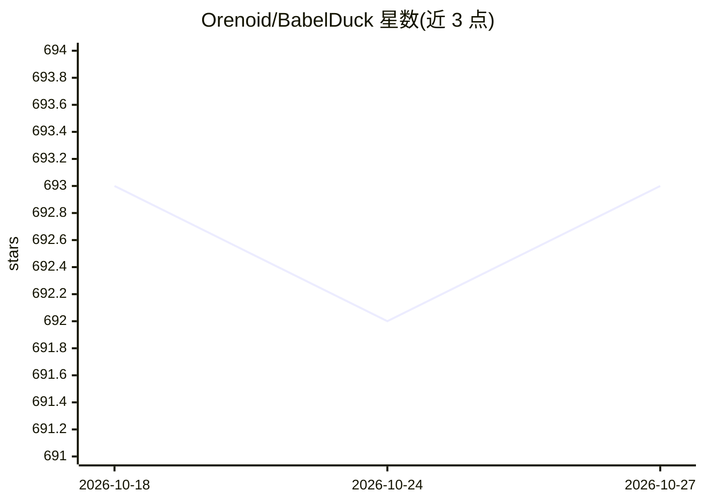

# Orenoid/BabelDuck

⭐ 693 · TypeScript · NOASSERTION · 推送 2026-04-07 · [GitHub](https://github.com/Orenoid/BabelDuck) · [官网](https://duck.orenoid.com) · 个人维护 · 中文 README

**面向语言学习者的 AI 口语对话练习应用，支持语音交互**

面向各水平语言学习者的 AI 对话练习应用，主打低门槛与低认知负荷的口语表达练习。提供多会话管理、自定义系统提示词、流式响应；可在不中断对话的情况下请求语法、翻译或表达润色建议，并对建议发起子对话追问；支持语音输入与语音回复，可集成多个 LLM 服务并切换，数据存储在本地，界面多语言并内置教程。通过 Docker 容器部署，克隆仓库后配置 .env 运行。

## 筛选速览

| 维度 | 判定 | 备注 |
|---|---|---|
| AI 角色 | `ai-native` | 本体是模型或模型工具 |
| 许可风险 | `none` | NOASSERTION |
| 部署形态 | `self-host` | docker 或自建部署 |
| 模型依赖 | — | README 未给出锁定关系 |
| 硬件要求 | — | 无带数字的原话,不猜 |
| 安装摩擦 | `low` | 无编译、无系统依赖或容器化 |
| 成熟度 | — | 结构信号不足 |

## 能力要点

- 不中断对话获取语法/翻译/润色建议，支持自定义快捷指令
- 对 AI 建议可发起子对话讨论后返回原对话
- 支持语音输入与语音回复
- 集成多个 LLM 服务并支持切换，数据本地存储

## 适用场景

- 初学者练习外语口语对话表达
- 在对话练习中即时获取语法纠错与表达润色
- 通过语音输入输出口语进行听说练习

## 场景标签

`聊天机器人` `语音 Agent` · 领域:对话与助手

## 证据(README 行号)

> L12: BabelDuck is a highly customizable AI conversation practice application designed for language learners of all level
> L20: - Integrates multiple LLM AI services with seamless switching

## 星数曲线

2026-10-18 693 → 2026-10-27 693（+0）

---
*卡片 v1 · prompt 1.4 · 生成 2026-10-21 · 置信度 high · 依据 README sha `d0c41d558cb9` · [字段定义](../../DATASET.md)*
