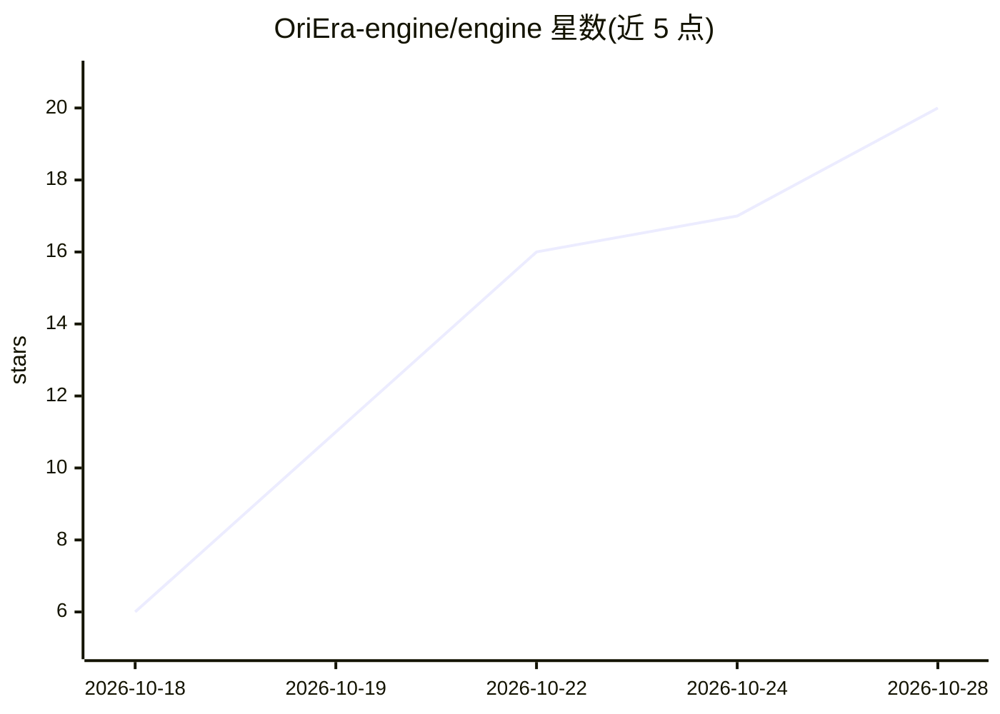

# OriEra-engine/engine

⭐ 20 · Rust · Apache-2.0 · 推送 2026-10-27 · [GitHub](https://github.com/OriEra-engine/engine) · [官网](https://oriera-engine.github.io/engine/) · 组织维护 · 中文 README

**AI 原生开放数字世界引擎：自然语言创作与自演化 3D 世界**

Rust 编写的实时 3D 世界运行时，采用 11 层架构，面向 PC/移动/Web/AR 五端（脑机接口 v1 仅预留）。核心机制：ECS 对象模型、wgpu/WebGPU 渲染、Jolt 物理、L9 认知层（NPC 记忆/对话/AI 导演，LangGraph + MCP 协议，v1 为规则解析，未来接 LLM）、L8 文生图/文生 3D。提供 14 个浏览器 demo、crates.io 库接入（oriera-agent 等）与 13 家模型供应商预设自检，另分发 Windows 桌面辅助工具 OriEra Studio。移动端与 AR 端尚在规划/适配中。

## 筛选速览

| 维度 | 判定 | 备注 |
|---|---|---|
| AI 角色 | `ai-ecosystem` | LLM/agent 周边工具 |
| 许可风险 | `permissive` | Apache-2.0 |
| 部署形态 | `library` | 以包/库形式分发 |
| 模型依赖 | — | README 未给出锁定关系 |
| 硬件要求 | — | 无带数字的原话,不猜 |
| 安装摩擦 | `low` | 无编译、无系统依赖或容器化 |
| 成熟度 | — | 结构信号不足 |

## 能力要点

- 11 层架构 + 五端 Capabilities 位图接入（脑机接口 v1 仅预留）
- L9 认知层：NPC 长期记忆、对话、AI 导演（LangGraph + MCP）
- L8 生成层：一句话主题 → 文生图/文生 3D → 热替换进世界
- 14 个浏览器可直接打开的 demo 与 crates.io 库接入（含 13 家供应商预设自检）

## 适用场景

- 用自然语言驱动和创造实时 3D 世界内容
- 构建带长期记忆与 AI 导演的 3D AI NPC 场景
- 在浏览器中体验引擎能力并二次开发 demo
- 作为 Rust 库（oriera-agent 等）接入自研项目

## 场景标签

`Agent 框架` `图像生成` · 领域:Agent 开发

## 证据(README 行号)

> L25: OriEra 不是又一个游戏引擎。我们要做的是：在 PC、手机、网页、AR 眼镜（以及未来的脑机接口）上，跑一个**能被 AI 驱动、能持续自我演化、用户可以用自然语言创造内容**的实时 3D 世界。
> L85: |Agent|LangGraph + MCP 协议（v1 规则解析，未来接 LLM）|
> L115: cargo add oriera-agent          # L9 认知：NPC 记忆/对话/导演（自动带入 L1-L8）

## 星数曲线

2026-10-18 6 → 2026-10-28 20（+14）

---
*卡片 v1 · prompt 1.4 · 生成 2026-10-28 · 置信度 mid · 依据 README sha `4e92a16e5add` · [字段定义](../../DATASET.md)*
