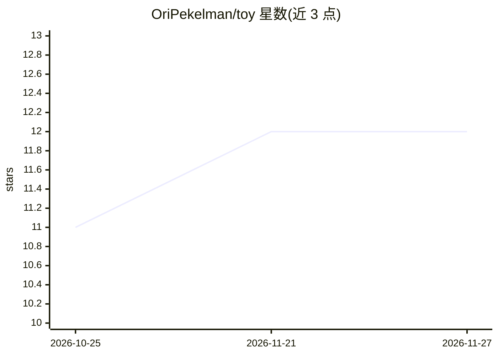

# OriPekelman/toy

⭐ 12 · Ruby · MIT · 推送 2026-11-26 · [GitHub](https://github.com/OriPekelman/toy) · 个人维护

**Ruby 编写的可读 Transformer LM 框架，编译为原生二进制**

用 Ruby 写成、经 Spinel 编译为原生二进制的 Transformer 语言模型框架，定位为「可读的机器学习」：前向传播一屏可读、逐形状注解、构建块以数学命名，并通过 bit-identical 门控验证与 PyTorch 输出对齐。支持运行 GGUF 格式模型（SmolLM2、Llama 3、Qwen 2.5/3、Mistral、Gemma 2、OLMoE 等），提供推理（KV-cache 解码、F32/Q8、mmap）、训练（从零训练、warm-start、LoRA）、逐 token logprob 评测及 OpenAI 兼容服务器，每项均为单一原生二进制。需要 Ruby、Spinel 与 C 编译器。

## 筛选速览

| 维度 | 判定 | 备注 |
|---|---|---|
| AI 角色 | `ai-ecosystem` | LLM/agent 周边工具 |
| 许可风险 | `permissive` | MIT |
| 部署形态 | `None` |  |
| 模型依赖 | local-ok | 支持本地模型 |
| 硬件要求 | — | 无带数字的原话,不猜 |
| 安装摩擦 | `medium` | 含编译或系统依赖之一 |
| 成熟度 | `idea` | |

## 能力要点

- CPU/CUDA/Metal 三后端，由 make verify-mirrors 保持 bit-identical
- algorithm_card：从 GGUF 元数据渲染 Phuong–Hutter 风格伪代码并可回解析为 Ruby
- 推理、训练（含 LoRA）、评测、OpenAI 兼容服务器各为单一原生二进制
- 五层框架栈（primitives→blocks→archs→engines→recipes），9 个 CLI 命令

## 适用场景

- 阅读与教学 Transformer 内部结构（逐形状注解的实现）
- 从零训练小型 Transformer 或对现有模型做 LoRA 微调
- 本地运行 GGUF 格式的开源 LLM 并启动兼容 OpenAI 的服务
- 以 gem 形式把模型构建块嵌入自己的 Ruby 项目

## 场景标签

`模型评测` `微调` `推理引擎` · 领域:评测与运维

## 证据(README 行号)

> L10: **Readable machine learning.** toy is a transformer LM framework in
> L32: Inference (KV-cache decode, F32/Q8, zero-copy mmap), training
> L100: the GGUF. CPU is the gated reference

## 星数曲线

2026-10-25 11 → 2026-11-27 12（+1）

---
*卡片 v1 · prompt 1.4 · 生成 2026-11-18 · 置信度 high · 依据 README sha `3b04d7c19771` · [字段定义](../../DATASET.md)*
