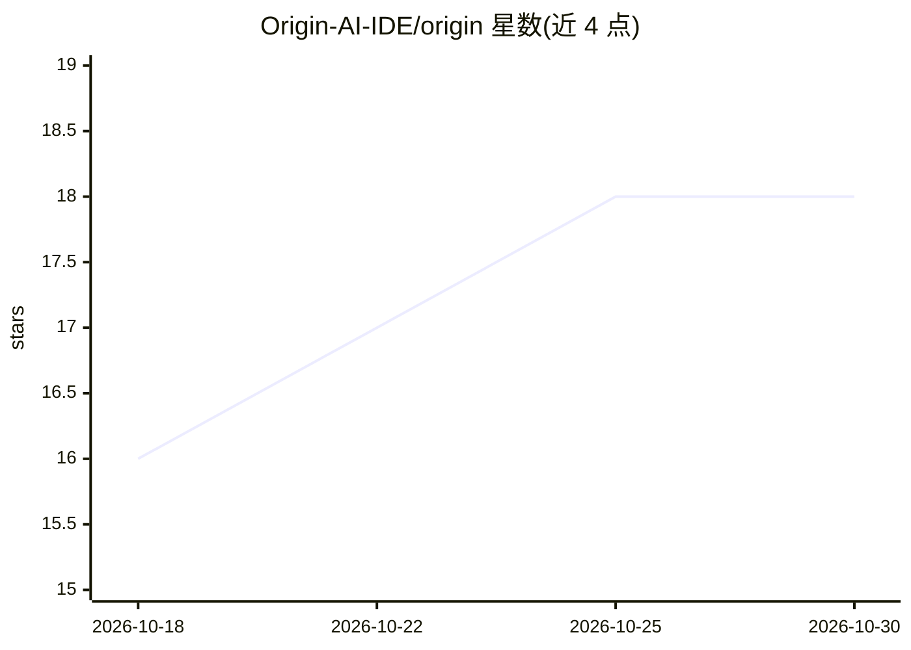

# Origin-AI-IDE/origin

⭐ 18 · TypeScript · Apache-2.0 · 推送 2026-07-04 · [GitHub](https://github.com/Origin-AI-IDE/origin) · [官网](https://origin.synapseresearch.org) · 组织维护

**轻量本地化 AI 代码编辑器，自带 API Key 跑 17 家模型**

基于 Tauri 2 与 React 构建的桌面 IDE，安装包约 5.8-10 MB，集成代码编辑器（CodeMirror 6）、真实 PTY 终端与 AI 面板。AI 部分支持 17 家提供商（含 Ollama/LM Studio/vLLM 本地后端），密钥存于 OS 钥匙串，请求经本地 Rust 代理转发，无遥测。提供 Agent/Plan/Ask 三种模式，读类工具自动执行、写与命令需审批，聊天记录存 SQLite。需注意 WebView2（Windows）为运行前提。

## 筛选速览

| 维度 | 判定 | 备注 |
|---|---|---|
| AI 角色 | `ai-enhanced` | 去掉 AI 部分产品仍成立 |
| 许可风险 | `permissive` | Apache-2.0 |
| 部署形态 | `desktop` | 安装包/桌面程序 |
| 模型依赖 | local-ok | 支持本地模型 |
| 硬件要求 | — | 无带数字的原话,不猜 |
| 安装摩擦 | `low` | 无编译、无系统依赖或容器化 |
| 成熟度 | — | 结构信号不足 |

## 能力要点

- Agent 模式最多 24 步工具调用，写文件与 bash 命令需用户审批
- 17 家 AI 提供商，密钥存 OS 钥匙串，请求走本地 Rust 代理
- CodeMirror 6 编辑器 + 真实 PTY 终端 + 内联 AI diff 审查
- Windows/macOS/Linux 提供安装包，Apache 2.0 许可

## 适用场景

- 用自己的 API Key 在本地 IDE 内进行 AI 辅助编码
- 让 AI 以计划-执行模式探索代码库并做多步修改
- 在无订阅、无遥测的桌面环境中管理代码与终端任务

## 场景标签

`编码 Agent` `AI 助手` · 领域:编码与开发

## 证据(README 行号)

> L39: Origin is a native desktop IDE built on Tauri 2 and React. It combines a full code editor, real terminal, and a dee
> L53: - **17 providers** - Anthropic, OpenAI, Gemini, OpenRouter, DeepSeek, Mistral, Groq, xAI, Cohere, Ollama, LM Studio

## 星数曲线

2026-10-18 16 → 2026-10-30 18（+2）

---
*卡片 v1 · prompt 1.4 · 生成 2026-10-29 · 置信度 mid · 依据 README sha `a4332510adcb` · [字段定义](../../DATASET.md)*
