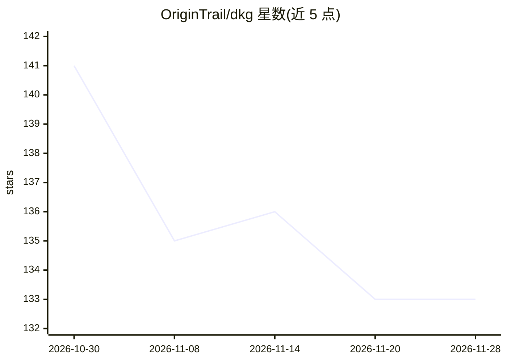

# OriginTrail/dkg

⭐ 133 · TypeScript · Apache-2.0 · 推送 2026-11-27 · [GitHub](https://github.com/OriginTrail/dkg) · [官网](https://origintrail.io) · 组织维护

**给多智能体系统提供可验证共享知识图谱记忆的节点软件**

DKG V10 节点 monorepo，包含节点守护进程、CLI、仪表盘 UI、协议包与适配器。以三层记忆结构（WM/SWM/VM）组织智能体知识：私有工作记忆、对等共享记忆、链上锚定的可验证记忆，知识以 RDF 三元组和 Knowledge Asset 形式发布，Merkle 根锚定区块链以校验完整性。提供 Hermes、OpenClaw 适配器与 MCP 集成，npm 全局安装后两条命令完成配置，支持 mainnet-gnosis、mainnet-base 与 testnet 网络，Core 节点需 TRAC 与 gas。

## 筛选速览

| 维度 | 判定 | 备注 |
|---|---|---|
| AI 角色 | `ai-ecosystem` | LLM/agent 周边工具 |
| 许可风险 | `permissive` | Apache-2.0 |
| 部署形态 | `library` | 以包/库形式分发 |
| 模型依赖 | — | README 未给出锁定关系 |
| 硬件要求 | — | 无带数字的原话,不猜 |
| 安装摩擦 | `low` | 无编译、无系统依赖或容器化 |
| 成熟度 | — | 结构信号不足 |

## 能力要点

- 三层记忆（WM→SWM→VM）按成本与信任逐级提升
- Knowledge Asset 以 Merkle 根锚定链上，可校验内容完整性
- 提供 Hermes/OpenClaw 适配器与 MCP 客户端一键接入
- CLI 覆盖 init/start/update/rollback/doctor 全生命周期

## 适用场景

- 让多个智能体共享并互相查询结构化知识
- 需要对发布知识做链上完整性校验的场景
- 通过 MCP 把知识图谱记忆接入编码客户端
- 运行节点参与 DKG 网络（edge 或 core 角色）

## 场景标签

`Agent 记忆` `多智能体` `知识图谱` `编码 Agent` · 领域:Agent 开发

## 证据(README 行号)

> L14: The Decentralized Knowledge Graph V10 is the shared, verifiable memory layer for multi-agent AI systems. Every find
> L18: This is the monorepo for the **Decentralized Knowledge Graph V10 node** — the node software, CLI, dashboard UI, pro
> L20: Any AI agent — whether built with OpenClaw, ElizaOS, Hermes, or any custom framework — can run a DKG node and start

## 星数曲线

2026-10-30 141 → 2026-11-28 133（-8）

---
*卡片 v1 · prompt 1.4 · 生成 2026-11-28 · 置信度 high · 依据 README sha `97a69b7e2a9b` · [字段定义](../../DATASET.md)*
