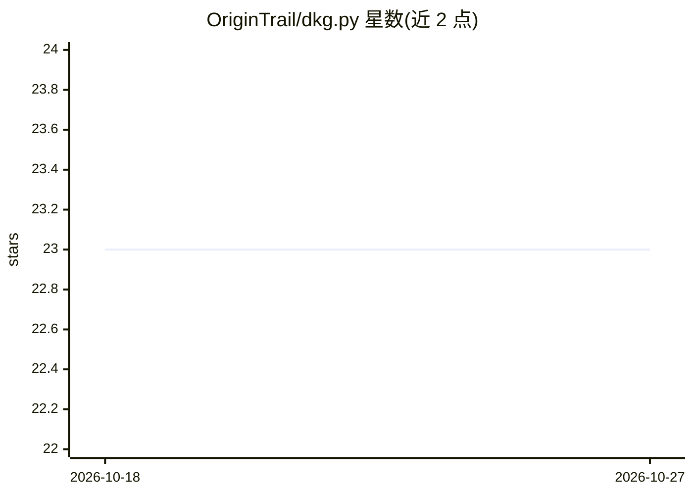

# OriginTrail/dkg.py

⭐ 23 · Python · Apache-2.0 · 推送 2026-02-13 · [GitHub](https://github.com/OriginTrail/dkg.py) · 组织维护

**与 OriginTrail 去中心化知识图谱交互的 Python SDK**

OriginTrail 官方提供的 Python SDK，用于与运行在 OriginTrail 去中心化网络（ODN）上的去中心化知识图谱（DKG）交互。DKG 基于 W3C 标准结合区块链与知识图谱技术，以 Knowledge Asset（含 UAL 标识与 NFT 所有权）为基本单位。SDK 以 web3.py 为基础开发，本地使用需 Python>=3.10、poetry>=1.5.1，并需运行本地 DKG 网络；通过 make install 安装依赖，make run-demo 运行示例。Apache-2.0 许可。

## 筛选速览

| 维度 | 判定 | 备注 |
|---|---|---|
| AI 角色 | `ai-ecosystem` | LLM/agent 周边工具 |
| 许可风险 | `permissive` | Apache-2.0 |
| 部署形态 | `None` |  |
| 模型依赖 | — | README 未给出锁定关系 |
| 硬件要求 | — | 无带数字的原话,不猜 |
| 安装摩擦 | `medium` | 含编译或系统依赖之一 |
| 成熟度 | — | 结构信号不足 |

## 能力要点

- 与 OriginTrail DKG 交互的 Python 客户端 SDK
- 基于 web3.py 构建
- 以 W3C 标准（DID/语义网）组织 Knowledge Asset
- 提供 make install 与 demo 运行流程

## 适用场景

- 在 Python 应用中读写 OriginTrail 知识图谱上的 Knowledge Asset
- 开发基于 DKG 的可信 AI 或 Web3 数据应用
- 本地搭建 DKG 网络并运行示例验证接入

## 场景标签

`知识图谱` · 领域:知识与检索

## 证据(README 行号)

> L7:  Python SDK for interacting with the OriginTrail Decentralized Knowledge Graph
> L52: **Anyone can run an OriginTrail node and become part of the ODN, contributing to the network capacity and hosting t
> L156: - web3.py: Basis for this project

## 星数曲线

2026-10-18 23 → 2026-10-27 23（+0）

---
*卡片 v1 · prompt 1.4 · 生成 2026-10-27 · 置信度 mid · 依据 README sha `8acedd3c11d0` · [字段定义](../../DATASET.md)*
