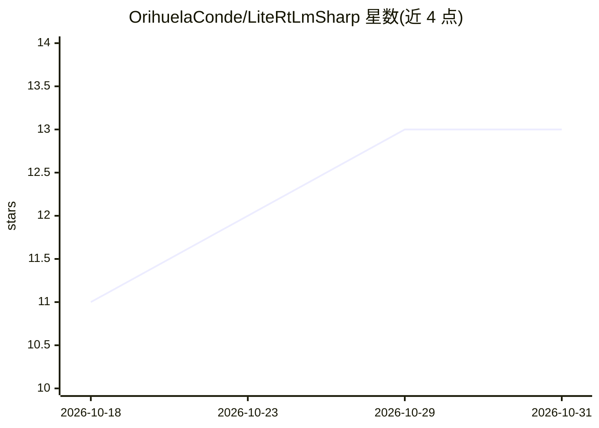

# OrihuelaConde/LiteRtLmSharp

⭐ 13 · C# · Apache-2.0 · 推送 2026-10-12 · [GitHub](https://github.com/OrihuelaConde/LiteRtLmSharp) · [官网](https://orihuelaconde.github.io/LiteRtLmSharp/) · 个人维护

**LiteRT-LM 的 .NET 绑定：让 .NET 应用端上运行 Gemma 等 LLM**

Google LiteRT-LM C API 的非官方 .NET 10 绑定，通过源码生成 P/Invoke 调用原生库，原生二进制按 RID 以 NuGet 包分发（LLamaSharp 风格）。支持 Windows/Linux/Android/macOS 的 CPU 与 GPU 推理，提供流式聊天、函数调用、Gemma reasoning、多模态、嵌入（EmbeddingGemma 2）、投机解码等能力，并可选接入 Microsoft.Extensions.AI 与 Semantic Kernel。限制：同一时刻仅允许一个 chat engine 存活；会话非线程安全；仅支持 .NET 10。

## 筛选速览

| 维度 | 判定 | 备注 |
|---|---|---|
| AI 角色 | `ai-ecosystem` | LLM/agent 周边工具 |
| 许可风险 | `permissive` | Apache-2.0 |
| 部署形态 | `library` | 以包/库形式分发 |
| 模型依赖 | — | README 未给出锁定关系 |
| 硬件要求 | — | 无带数字的原话,不猜 |
| 安装摩擦 | `medium` | 含编译或系统依赖之一 |
| 成熟度 | — | 结构信号不足 |

## 能力要点

- P/Invoke 绑定 LiteRT-LM C API，原生二进制按 RID 以 NuGet 分发
- 多平台 CPU/GPU 推理（win/linux/android/osx，iOS 待验证）
- 聊天、函数调用、多模态、嵌入、投机解码、对话状态持久化
- 可选 Extensions.AI / SemanticKernel 伴生包接入 .NET AI 生态

## 适用场景

- 在 MAUI 移动应用中离线运行 Gemma 聊天与多模态推理
- .NET 桌面/服务端应用本地运行 LLM，不依赖云端
- 在 .NET 中做端上 RAG（嵌入模型与聊天模型并存）

## 场景标签

`推理引擎` `多模态` `RAG` · 领域:知识与检索

## 证据(README 行号)

> L19: .NET 10 bindings for Google's LiteRT-LM — on-device
> L21: NuGet packages (LLamaSharp-style). Status: **stable (1.x)**.
> L87: Two optional companion packages plug the on-device model into the .NET AI ecosystem:

## 星数曲线

2026-10-18 11 → 2026-10-31 13（+2）

---
*卡片 v1 · prompt 1.4 · 生成 2026-10-31 · 置信度 mid · 依据 README sha `39f02801362d` · [字段定义](../../DATASET.md)*
