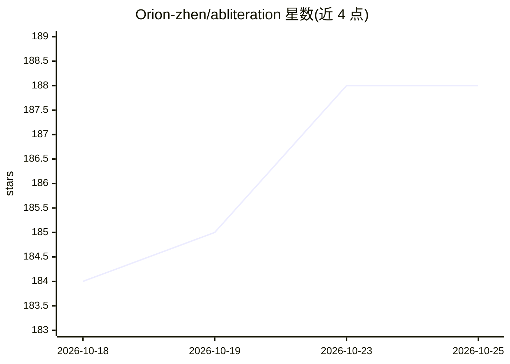

# Orion-zhen/abliteration

⭐ 188 · Python · GPL-3.0 · 推送 2026-10-21 · [GitHub](https://github.com/Orion-zhen/abliteration) · 个人维护

**用 transformers 计算并移除 LLM 拒绝方向的模型修改工具**

基于 HuggingFace transformers 的 abliteration 实现：用有害/无害提示计算模型最显著的拒绝方向，再从权重矩阵中减去该方向成分，从而移除模型的显式拒绝行为。提供 Simple、Biprojection、Norm-Preserving 与 Full 四种消融方法，通过 YAML 配置文件驱动 abliterate.py 运行，附带 chat.py 对话脚本与 compare.py 双模型对比脚本。已在 Llama-3.2、Qwen2.5-Coder、Ministral-8b 上测试；作者声明为概念验证实现，未广泛测试，部分模型可能出现 NaN/Inf 权重。

## 筛选速览

| 维度 | 判定 | 备注 |
|---|---|---|
| AI 角色 | `ai-ecosystem` | LLM/agent 周边工具 |
| 许可风险 | `viral` | GPL-3.0 |
| 部署形态 | `library` | 以包/库形式分发 |
| 模型依赖 | — | README 未给出锁定关系 |
| 硬件要求 | — | 无带数字的原话,不猜 |
| 安装摩擦 | `low` | 无编译、无系统依赖或容器化 |
| 成熟度 | `idea` | |

## 能力要点

- 用有害/无害提示计算拒绝方向并从权重中移除
- 支持 Simple / Biprojection / Norm-Preserving / Full 四种方法
- 提供对话测试与双模型对比脚本
- 支持 bitsandbytes 4-bit 加载以降低 VRAM 占用

## 适用场景

- 研究者复现 abliteration 技术并对比不同消融方法
- 对自有模型移除拒绝方向后测试对话表现
- 实验模型安全对齐与拒绝行为的关系

## 场景标签

 · 领域:LLM 研究/模型修改

## 证据(README 行号)

> L12: There exist some directions that make LLMs to refuse users' input. Abliteration is a technique that can calculate t
> L14: The code has been tested on Llama-3.2, Qwen2.5-Coder, Ministral-8b.
> L34: pip install -r requirements.txt # or requirements.rocm.txt if you have AMD GPU

## 星数曲线

2026-10-18 184 → 2026-10-25 188（+4）

---
*卡片 v1 · prompt 1.4 · 生成 2026-10-23 · 置信度 mid · 依据 README sha `62868de9352b` · [字段定义](../../DATASET.md)*
