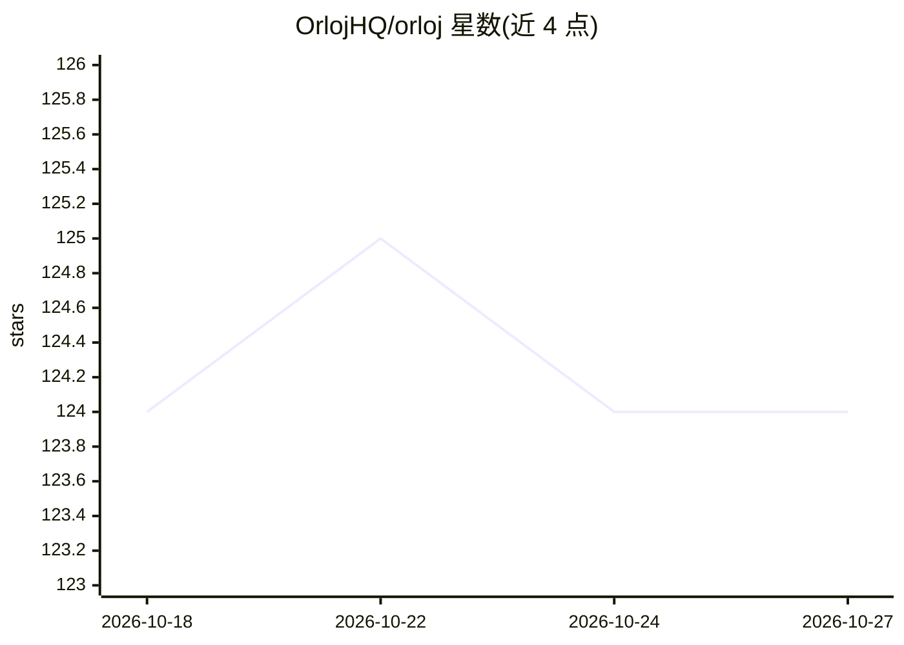

# OrlojHQ/orloj

⭐ 124 · Go · Apache-2.0 · 推送 2026-10-23 · [GitHub](https://github.com/OrlojHQ/orloj) · [官网](https://orloj.dev) · 组织维护

**多智能体系统的一体化编排运行时：YAML 声明、调度、治理**

开源的多智能体系统编排运行时：以 YAML 清单声明 Agent、AgentSystem 图、模型端点、工具、记忆、触发器与策略，由控制器校验资源、调度任务，Worker 以租约/心跳认领并执行，支持重试、幂等键与死信状态。模型层经 ModelEndpoint 路由到 OpenAI、Anthropic、AWS Bedrock、Azure OpenAI、Ollama 及 OpenAI 兼容端点；治理层含策略、角色、工具权限与人工审批，未授权操作在运行时失败关闭。可观测性提供 trace、日志、Prometheus 指标与 OpenTelemetry。本地可用内嵌 Worker 与内存态单进程运行，扩展至 Postgres、NATS JetStream 与分布式 Worker。项目自述处于活跃开发期，1.0 前接口与资源模式可能变更。

## 筛选速览

| 维度 | 判定 | 备注 |
|---|---|---|
| AI 角色 | `ai-ecosystem` | LLM/agent 周边工具 |
| 许可风险 | `permissive` | Apache-2.0 |
| 部署形态 | `self-host` | docker 或自建部署 |
| 模型依赖 | local-ok | 支持本地模型 |
| 硬件要求 | — | 无带数字的原话,不猜 |
| 安装摩擦 | `low` | 无编译、无系统依赖或容器化 |
| 成熟度 | `idea` | |

## 能力要点

- YAML 声明 Agent/系统/工具/模型/策略，经单一 API 应用
- Worker 租约、心跳、重试、幂等键与死信状态的执行运行时
- 治理在运行时评估：AgentPolicy、ToolPermission、Tool/TaskApproval，未授权失败关闭
- ModelEndpoint 路由多提供商并支持 fallback；trace/日志/Prometheus/OpenTelemetry 可观测

## 适用场景

- 把 agent 脚本迁移为版本化清单管理的生产系统
- 多 agent 流水线、扇出扇入与人工审批节点的一体化运行
- 对工具调用做授权、隔离、审批与审计追踪
- 本地单进程开发后扩展到 Postgres+NATS 分布式 Worker

## 场景标签

`Agent 框架` `多智能体` · 领域:Agent 开发

## 证据(README 行号)

> L7: Build, run, govern, and observe multi-agent systems from one declarative stack: agents, tools, models, memory, sched
> L17: Orloj is the open-source full stack for developing and operating agentic systems.
> L32: Orloj is not a single runtime component. It spans the layers teams need to develop, run, govern, and observe agenti

## 星数曲线

2026-10-18 124 → 2026-10-27 124（+0）

---
*卡片 v1 · prompt 1.4 · 生成 2026-10-23 · 置信度 mid · 依据 README sha `e0fd7d71dbb2` · [字段定义](../../DATASET.md)*
