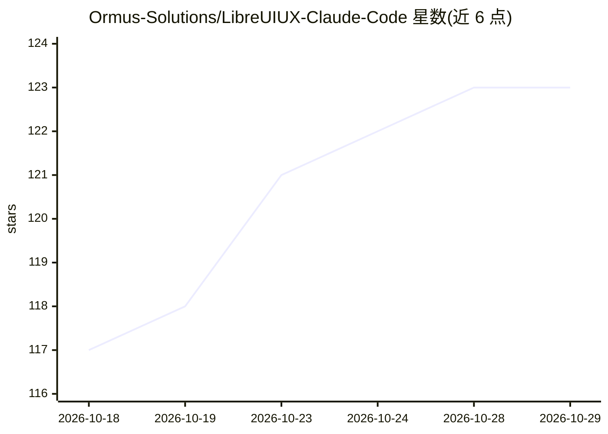

# Ormus-Solutions/LibreUIUX-Claude-Code

⭐ 123 · Shell · MIT · 推送 2026-10-04 · [GitHub](https://github.com/Ormus-Solutions/LibreUIUX-Claude-Code) · [官网](https://ormus.solutions) · 个人维护

**给 Claude Code 的 UI/UX 插件市场：71 插件/152 agents/74 skills**

面向使用 Claude Code（及 Grok Build）做前端开发的插件市场：提供 71 个可安装插件，内含 152 个 agent 定义（93 个去重）、76 个 slash 命令、74 个技能与 3 个可选 hooks，覆盖设计精通、无障碍合规、后端集成、测试与 DevOps 等类别。安装走 Claude Code 的 /plugin marketplace 命令、grok CLI 或 setup.sh 脚本，也提供 CLAUDE.md 模板、提示词库等按层级（初级/中级/高级）组织的学习路径。2.0.0 将市场名从 claude-code-workflows 改为 libreuiux，并给出迁移步骤。MIT 许可。

## 筛选速览

| 维度 | 判定 | 备注 |
|---|---|---|
| AI 角色 | `ai-ecosystem` | LLM/agent 周边工具 |
| 许可风险 | `permissive` | MIT |
| 部署形态 | `None` |  |
| 模型依赖 | locked-api |  |
| 硬件要求 | — | 无带数字的原话,不猜 |
| 安装摩擦 | `low` | 无编译、无系统依赖或容器化 |
| 成熟度 | — | 结构信号不足 |

## 能力要点

- 71 个插件按前端、后端、测试、DevOps、专项领域分类
- 152 agent 定义/76 命令/74 技能/3 hooks 的分层组件体系
- 支持 Claude Code 与 Grok Build 两种 CLI 安装路径及 setup.sh 批量安装
- 提供 CLAUDE.md 模板、提示词模板等无需安装插件的轻量路径

## 适用场景

- 让 Claude Code 生成的前端组件符合现代设计规范
- 为项目按需安装无障碍、设计系统或测试类插件
- 从初级提示词到高级 MCP 工作流逐步建立 AI 辅助 UI/UX 开发流程

## 场景标签

`提示工程` · 领域:Agent 开发

## 证据(README 行号)

> L5:  Complete UI/UX system for Claude Code -- 71 plugins, 152 agents, 76 commands, 74 skills, 3 hooks
> L74: /plugin marketplace add HermeticOrmus/LibreUIUX-Claude-Code
> L104: From a clone, `./setup.sh --grok` installs every plugin through the `grok` CLI; `--only`, `--list`, and `--uninsta

## 星数曲线

2026-10-18 117 → 2026-10-29 123（+6）

---
*卡片 v1 · prompt 1.4 · 生成 2026-10-23 · 置信度 high · 依据 README sha `f7784fb7d4d2` · [字段定义](../../DATASET.md)*
