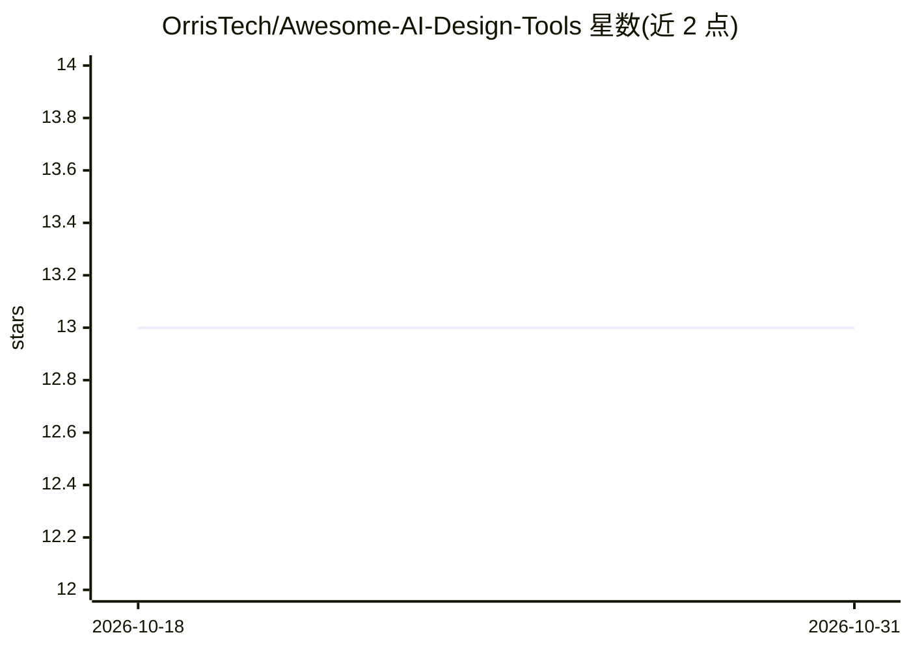

# OrrisTech/Awesome-AI-Design-Tools

⭐ 13 · 推送 2026-09-27 · [GitHub](https://github.com/OrrisTech/Awesome-AI-Design-Tools) · [官网](https://designaitool.com) · 组织维护

**AI 设计工具策展清单：按设计领域分类收录工具条目**

一个 Awesome 风格的策展清单，收录约百余个 AI 设计相关工具条目，按平面设计（品牌 Logo、插画艺术）、工业设计、室内设计、建筑设计、游戏设计、UI/UX 设计等类别组织。条目为工具名加一句话简介，覆盖图像生成、视频创作、SEO 内容、合同管理、转录等多种 SaaS 产品，部分条目为开源工具（如 PearAI、Orkas）。README 未提供安装方式或筛选标准说明，未标注赞助或合作信息。

## 筛选速览

| 维度 | 判定 | 备注 |
|---|---|---|
| AI 角色 | `ai-knowledge` | 知识聚合/清单类 |
| 许可风险 | `none` | — |
| 部署形态 | `None` |  |
| 模型依赖 | — | README 未给出锁定关系 |
| 硬件要求 | — | 无带数字的原话,不猜 |
| 安装摩擦 | `low` | 无编译、无系统依赖或容器化 |
| 成熟度 | — | 结构信号不足 |

## 能力要点

- 按 7 个以上设计领域类别组织条目
- 覆盖图像生成、视频、室内/建筑/游戏设计等方向的工具条目
- 条目格式为工具名加一句话简介

## 适用场景

- 按设计领域浏览和发现 AI 设计工具
- 为设计工作流选型时查找候选工具
- 了解 AI 设计工具的品类分布

## 场景标签

`精选清单` · 领域:学习与行业

## 证据(README 行号)

> L3: A collection of the best AI design tools to enhance your creativity, productivity, and business management.
> L5: ## Graphic Design: Branding & Logo Design

## 星数曲线

2026-10-18 13 → 2026-10-31 13（+0）

---
*卡片 v1 · prompt 1.4 · 生成 2026-10-31 · 置信度 high · 依据 README sha `f377d07f0f84` · [字段定义](../../DATASET.md)*
