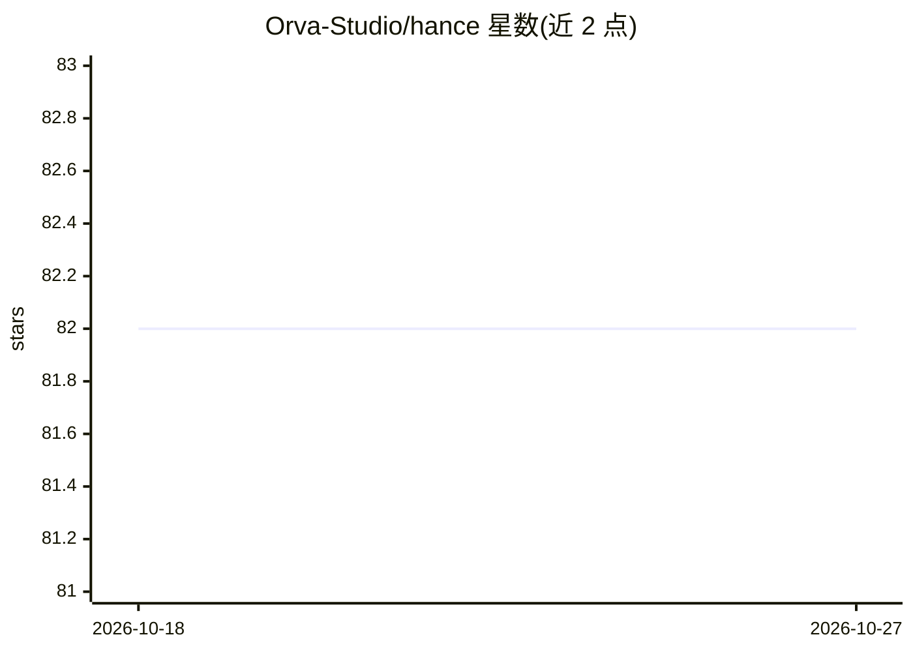

# Orva-Studio/hance

⭐ 82 · TypeScript · NOASSERTION · 推送 2026-10-08 · [GitHub](https://github.com/Orva-Studio/hance) · [官网](https://hance.video/) · 组织维护

**命令行电影感视频调色/特效工具，可被 AI agent 驱动**

面向视频创作者与 agent 的 CLI 工具：在浏览器中预览电影感 look，再用 CLI 批量应用。效果包括调色、halation、bloom、颗粒、暗角、split-tone、色差与镜头抖动，GPU 加速，单二进制无需插件。二进制支持 macOS（arm64/x64）与 Linux（x64/arm64），Windows 不支持，Linux 测试较少。二进制内置 agent skill，供 AI harness 在运行时获取版本匹配的指令，并可通过 Claude Code 以自然语言驱动。采用 FSL-1.1 许可，禁止用于构建竞争产品，2028 年 4 月转为 Apache 2.0。

## 筛选速览

| 维度 | 判定 | 备注 |
|---|---|---|
| AI 角色 | `ai-enhanced` | 去掉 AI 部分产品仍成立 |
| 许可风险 | `none` | NOASSERTION |
| 部署形态 | `library` | 以包/库形式分发 |
| 模型依赖 | — | README 未给出锁定关系 |
| 硬件要求 | — | 无带数字的原话,不猜 |
| 安装摩擦 | `medium` | 含编译或系统依赖之一 |
| 成熟度 | `idea` | |

## 能力要点

- GPU 加速的电影感效果管线（调色/halation/bloom/颗粒/暗角/色差/镜头抖动）
- 单二进制发布，UI 预览 look 后按名批量应用于视频
- 内置 agent skill，供任意 AI harness 获取版本匹配的指令
- 支持通过 Claude Code 以自然语言驱动

## 适用场景

- 给视频批量套用电影感调色与胶片颗粒等效果
- 在浏览器里预览调好 look 后交给 CLI 处理成片
- 让 AI agent 通过自然语言执行视频精修流程

## 场景标签

`图像视频处理` · 领域:感知与多模态

## 证据(README 行号)

> L5: **Preview a cinematic film look in the browser, then batch-apply it from the CLI.** GPU-accelerated colour, halation
> L22: The `hance` binary carries its own agent skill so any AI harness gets version-matched instructions at runtime:

## 星数曲线

2026-10-18 82 → 2026-10-27 82（+0）

---
*卡片 v1 · prompt 1.4 · 生成 2026-10-24 · 置信度 high · 依据 README sha `15e5205899f1` · [字段定义](../../DATASET.md)*
