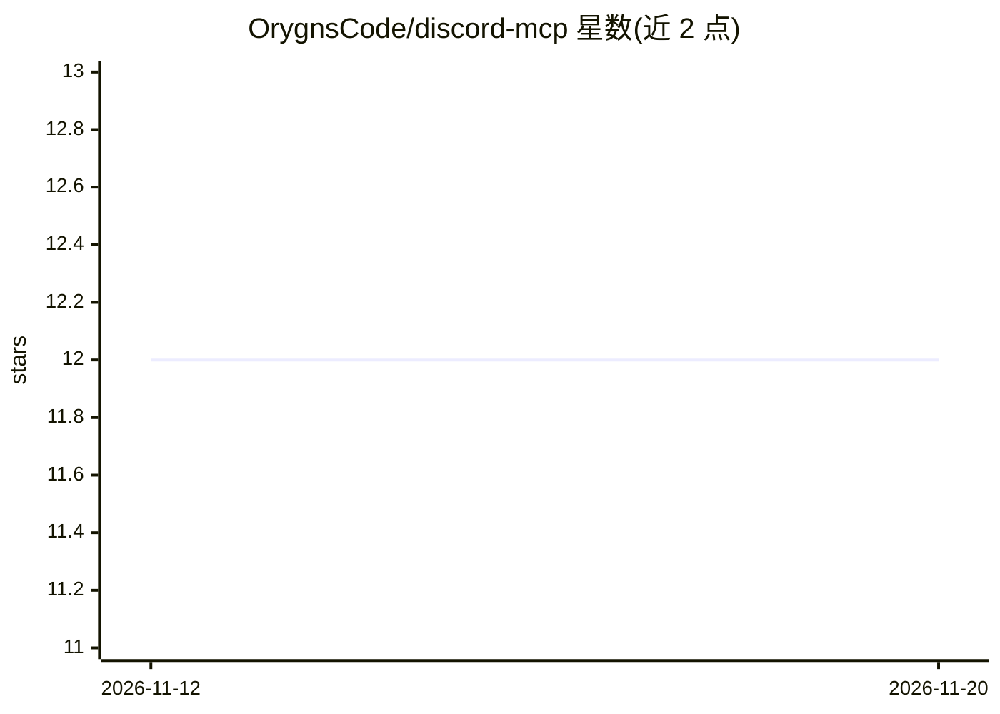

# OrygnsCode/discord-mcp

⭐ 12 · TypeScript · Apache-2.0 · 推送 2026-11-19 · [GitHub](https://github.com/OrygnsCode/discord-mcp) · [官网](https://orygn.tech/products/discord-mcp) · 个人维护

**让 AI 客户端通过 MCP 管理 Discord 服务器的工具集**

一个 Model Context Protocol 服务器，把 Discord 服务器的聊天、消息、审核、AutoMod、服务器搭建等 164 个工具暴露给 AI 客户端调用。本体内不含 LLM 和云服务，仅通过用户自己的 bot token 与 Discord 通信；破坏性操作经预览加单次确认 token 控制，支持 MCP elicitation 弹窗由人确认。Node 22+ 运行，npx 一条命令完成向导式安装并写入客户端配置，另有源码与 Docker 部署方式，支持 stdio 与 HTTP 两种传输。

## 筛选速览

| 维度 | 判定 | 备注 |
|---|---|---|
| AI 角色 | `ai-ecosystem` | LLM/agent 周边工具 |
| 许可风险 | `permissive` | Apache-2.0 |
| 部署形态 | `self-host` | docker 或自建部署 |
| 模型依赖 | — | README 未给出锁定关系 |
| 硬件要求 | — | 无带数字的原话,不猜 |
| 安装摩擦 | `low` | 无编译、无系统依赖或容器化 |
| 成熟度 | — | 结构信号不足 |

## 能力要点

- 164 个工具覆盖服务器搭建、消息、审核、AutoMod、安全审计等
- 破坏性操作需预览与单次确认 token，AI 无法代替用户回答弹窗
- 向导自动检测并写入 Claude Desktop/Cursor/Windsurf/Claude Code 配置
- 支持 stdio 与 HTTP 传输、多 bot 管理与操作撤销

## 适用场景

- 用一段描述让 AI 生成并搭建完整的 Discord 社区服务器
- 通过对话完成禁言、封禁、Bulk 操作等审核任务
- 审计服务器权限配置，发现可提权角色与高危 bot

## 场景标签

 · 领域:AI 工具基础设施/MCP 服务器

## 证据(README 行号)

> L12: discord-mcp is a Model Context Protocol (MCP) server that gives your AI
> L30: AI cannot answer for you. There is no LLM inside it and no cloud
> L26: other MCP client) is the brain. discord-mcp is the hands: it talks to

## 星数曲线

2026-11-12 12 → 2026-11-20 12（+0）

---
*卡片 v1 · prompt 1.4 · 生成 2026-11-18 · 置信度 high · 依据 README sha `3a43c4366aef` · [字段定义](../../DATASET.md)*
