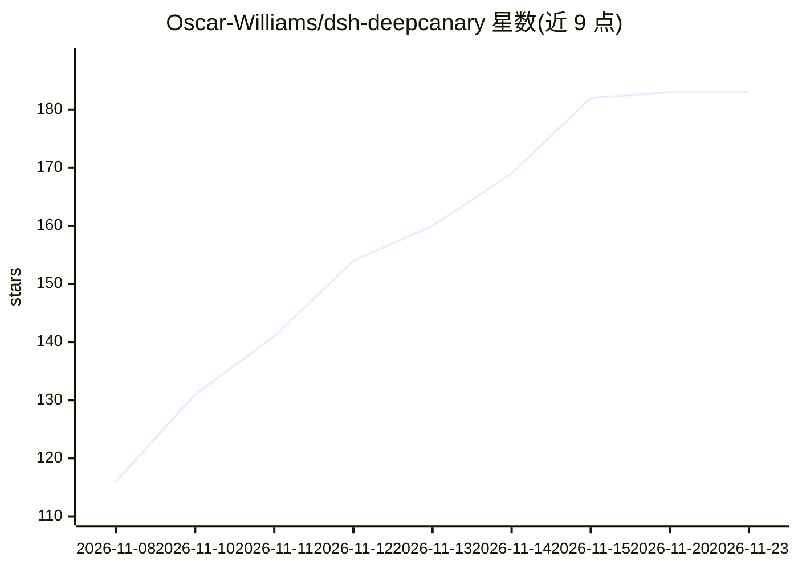

# Oscar-Williams/dsh-deepcanary

⭐ 183 · TypeScript · MIT · 推送 2026-11-04 · [GitHub](https://github.com/Oscar-Williams/dsh-deepcanary) · [官网](https://www.npmjs.com/package/dsh-deepcanary) · 个人维护 · 中文 README

**DeepSeek Harness 的任务收件箱与本地通知插件**

面向 DeepSeek Harness（DSH）用户的第三方插件：将任务更新归入 Pending / Snoozed / Activity 三类视图，在 DSH 等待回答或审批时发出本地提醒，点击通知可跳回对应会话。提供 C1–C3 三级提醒、免打扰时段与每小时 C2 中断上限配置，面板支持停靠、拖拽与键盘布局调整，布局按设备记忆。要求 DSH 0.2.1-rc.5 / 0.2.2-alpha.3 及以上；Windows Desktop 通过插件市场安装，WebUI 通过 dsh plugin 命令安装。提醒元数据保存在本地 DSH 数据目录，通知决策基于本地规则。

## 筛选速览

| 维度 | 判定 | 备注 |
|---|---|---|
| AI 角色 | `ai-ecosystem` | LLM/agent 周边工具 |
| 许可风险 | `permissive` | MIT |
| 部署形态 | `None` |  |
| 模型依赖 | locked-api |  |
| 硬件要求 | — | 无带数字的原话,不猜 |
| 安装摩擦 | `low` | 无编译、无系统依赖或容器化 |
| 成熟度 | — | 结构信号不足 |

## 能力要点

- Pending / Snoozed / Activity 三视图任务收件箱，可跳回对应 DSH 会话
- C1–C3 三级提醒与免打扰时段、每小时 C2 中断上限
- 面板停靠、拖拽、键盘调整，布局按设备记忆
- 提醒元数据存于本地，通知决策使用本地规则

## 适用场景

- 运行长任务时在 DSH 需要审批或回答时收到提醒
- 把常规完成事项归入 Activity，减少通知噪音
- 在免打扰时段只保留需要人工介入的 C3 提醒

## 场景标签

 · 领域:AI agent 工具/可观测性

## 证据(README 行号)

> L3:  A task inbox and local notifications for DeepSeek Harness.
> L20: DeepCanary **0.1.9-rc.1** requires DSH `0.2.1-rc.5` or `0.2.2-alpha.3` and later. Check the Node.js requirements fo

## 星数曲线

2026-11-08 116 → 2026-11-23 183（+67）

---
*卡片 v1 · prompt 1.4 · 生成 2026-11-17 · 置信度 high · 依据 README sha `fa783629c70a` · [字段定义](../../DATASET.md)*
