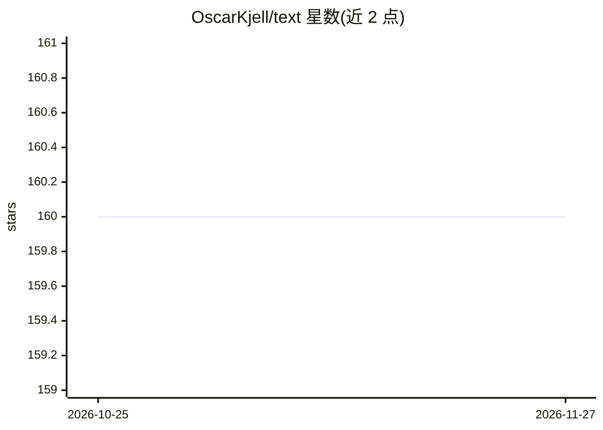

# OscarKjell/text

⭐ 160 · R · 推送 2026-11-12 · [GitHub](https://github.com/OscarKjell/text) · [官网](https://r-text.org) · 个人维护

**让 R 用户用 Hugging Face transformers 做文本嵌入与分析**

R 语言分析套件中的核心包：第一目标是作为 point solution，将文本转换为可下游使用的词嵌入，通过 Python 接口接入 Hugging Face 的 transformers 模型（BERT、RoBERTa、DistilBERT、多语言 BERT 等）；第二目标是面向社会与行为科学家的端到端方案，提供 textTrain() 预测数值/分类变量、词嵌入空间显著性词可视化等分析函数。套件另含 talk（语音转文本/嵌入）与 topics（主题可视化）包及心理学评估预训练模型库 L-BAM。套件在 Ubuntu、Mac OS、Windows 上用最新稳定版 R 持续测试。

## 筛选速览

| 维度 | 判定 | 备注 |
|---|---|---|
| AI 角色 | `ai-native` | 本体是模型或模型工具 |
| 许可风险 | `none` | — |
| 部署形态 | `None` |  |
| 模型依赖 | — | README 未给出锁定关系 |
| 硬件要求 | — | 无带数字的原话,不猜 |
| 安装摩擦 | `low` | 无编译、无系统依赖或容器化 |
| 成熟度 | — | 结构信号不足 |

## 能力要点

- 将文本转换为 transformers 词嵌入的 R 接口
- textTrain() 用嵌入预测数值或分类变量
- 支持多语言模型（如多语言 BERT 覆盖 104 种语言）
- 配套 talk、topics 包与心理学评估模型库 L-BAM

## 适用场景

- 在 R 中为下游任务生成文本嵌入
- 研究文本嵌入与数值/分类变量的预测关系
- 对社会与行为科学文本数据做统计分析与可视化

## 场景标签

`数据分析` `科研工具` · 领域:效率与自动化

## 证据(README 行号)

> L18: An R-package for analyzing natural language with transformers-based
> L42: The *text*-package has two main objectives: \* First, to serve
> L43: R-users as a *point solution* for transforming text to state-of-the-art

## 星数曲线

2026-10-25 160 → 2026-11-27 160（+0）

---
*卡片 v1 · prompt 1.4 · 生成 2026-11-27 · 置信度 high · 依据 README sha `6ad81e8d08f2` · [字段定义](../../DATASET.md)*
