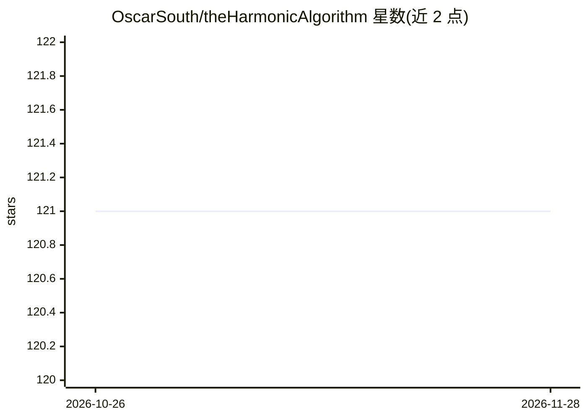

# OscarSouth/theHarmonicAlgorithm

⭐ 121 · Haskell · GPL-3.0 · 推送 2026-11-20 · [GitHub](https://github.com/OscarSouth/theHarmonicAlgorithm) · [官网](https://theHarmonicAlgorithm.com) · 个人维护

**为作曲者/演奏者实时生成与控制和声进行的 Haskell 工具**

以 Haskell 库实现的实时和声导航与生成系统，与 TidalCycles 深度集成用于 live coding：在用户定义的音乐约束内生成和声状态，用基于耶鲁古典语料库训练的 Markov 链矩阵立方排序，和声转换存于 Neo4j 图数据库供作曲家风格混合检索。明确声明不含 AI，采用规则→评估→遍历管线。提供熵控制、Spectral Narrative 宏观结构、配器系统等组件；依赖 GHC 9.10.3、TidalCycles + SuperCollider，图数据库路径需 Docker；Linux 提供一键安装脚本，macOS 尚无对应脚本。

## 筛选速览

| 维度 | 判定 | 备注 |
|---|---|---|
| AI 角色 | `ai-enhanced` | 去掉 AI 部分产品仍成立 |
| 许可风险 | `viral` | GPL-3.0 |
| 部署形态 | `None` |  |
| 模型依赖 | — | README 未给出锁定关系 |
| 硬件要求 | — | 无带数字的原话,不猜 |
| 安装摩擦 | `low` | 无编译、无系统依赖或容器化 |
| 成熟度 | — | 结构信号不足 |

## 能力要点

- Rules→Evaluation→Traversal 管线基于 10,000+ 作品的转换概率生成和声进行
- 与 TidalCycles 集成支持 live coding 实时演奏
- Neo4j 图库支持作曲家风格加权混合（如 bach:30 debussy:70）
- 熵参数控制熟悉与意外的平衡；无数据库时可回退内置协和度模式

## 适用场景

- 作为作曲辅助工具生成和声进行
- 现场演出中实时演奏和声与管弦织体
- 学习和声理论或做作品分析

## 场景标签

 · 领域:音乐/算法作曲

## 证据(README 行号)

> L14: ###### This codebase is an expression of my musical mind -- it provides structure for navigating through and intera
> L16: The Harmonic Algorithm system, intergrated with TidalCycles, generates
> L34: No AI -- just counting and music theory.

## 星数曲线

2026-10-26 121 → 2026-11-28 121（+0）

---
*卡片 v1 · prompt 1.4 · 生成 2026-11-28 · 置信度 mid · 依据 README sha `fa6e7843112f` · [字段定义](../../DATASET.md)*
