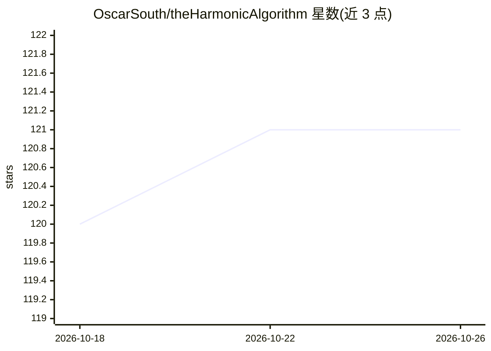

# OscarSouth/theHarmonicAlgorithm

⭐ 121 · Haskell · GPL-3.0 · 推送 2026-10-21 · [GitHub](https://github.com/OscarSouth/theHarmonicAlgorithm) · [官网](https://theHarmonicAlgorithm.com) · 个人维护

**给作曲/演奏者的实时和声生成系统，Haskell 实现**

基于 Haskell 的音乐和声生成库，与 TidalCycles 深度集成用于 live coding：在用户设定的音乐约束内生成和声状态，用基于 Yale Classical Archives Corpus（488 位作曲家）训练的马尔可夫链矩阵立方体进行排序，和声转移存储在 Neo4j 图数据库中。系统遵循规则→评估→遍历流水线，支持熵值控制、作曲家风格加权混合、无数据库的降级运行模式，另含管弦乐编排与曲式框架组件。作者声明其中无 AI，仅为计数与音乐理论实现。安装需 Haskell Stack（GHC 9.10.3）、TidalCycles 与 SuperCollider，可选 Docker 运行 Neo4j 图数据库，提供 Linux 自动化安装脚本。

## 筛选速览

| 维度 | 判定 | 备注 |
|---|---|---|
| AI 角色 | `ai-native` | 本体是模型或模型工具 |
| 许可风险 | `viral` | GPL-3.0 |
| 部署形态 | `None` |  |
| 模型依赖 | — | README 未给出锁定关系 |
| 硬件要求 | — | 无带数字的原话,不猜 |
| 安装摩擦 | `low` | 无编译、无系统依赖或容器化 |
| 成熟度 | — | 结构信号不足 |

## 能力要点

- Rules→Evaluation→Traversal 流水线生成和声进行
- 488 位作曲家的转移概率存于 Neo4j 图数据库，支持按名或加权混合查询
- 熵值参数控制熟悉与新奇和声的平衡
- 可无图数据库降级运行（内置协和度回退）

## 适用场景

- 在 TidalCycles live coding 中实时生成符合约束的和声进行
- 作为作曲辅助或和声分析工具
- 混合多位作曲家的和声风格进行即兴演奏与现场演出

## 场景标签

 · 领域:音乐/算法作曲

## 证据(README 行号)

> L18: ranks it using a tailored 'cube' of Markov Chain matrices trained on the
> L33: No AI -- just counting and music theory.
> L29: integration for live coding. Under the hood, harmonic transitions from over

## 星数曲线

2026-10-18 120 → 2026-10-26 121（+1）

---
*卡片 v1 · prompt 1.4 · 生成 2026-10-23 · 置信度 mid · 依据 README sha `f33af4a73d6a` · [字段定义](../../DATASET.md)*
