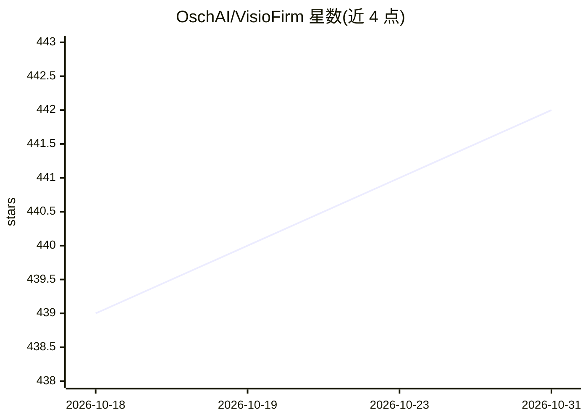

# OschAI/VisioFirm

⭐ 442 · Python · Apache-2.0 · 推送 2026-08-20 · [GitHub](https://github.com/OschAI/VisioFirm) · [官网](https://arxiv.org/abs/2509.04180) · 个人维护

**面向计算机视觉的 AI 辅助图像/视频标注工具**

开源的跨平台图像与视频标注工具，面向研究人员、数据科学家与 ML 工程师。用 YOLO（v5–v12）、SAM2、Grounding DINO、CLIP 等模型做半自动预标注，支持分类、边界框、旋转框、多边形分割与视频帧间传播标注；提供浏览器交互画布、SQLite 项目管理、YOLO/COCO 导出、Python API 与用户管理 CLI。pip 安装后单命令启动本地 Web 服务；模型自动下载，支持离线预取。

## 筛选速览

| 维度 | 判定 | 备注 |
|---|---|---|
| AI 角色 | `ai-ecosystem` | LLM/agent 周边工具 |
| 许可风险 | `permissive` | Apache-2.0 |
| 部署形态 | `library` | 以包/库形式分发 |
| 模型依赖 | — | README 未给出锁定关系 |
| 硬件要求 | `cpu-ok` | |
| 安装摩擦 | `low` | 无编译、无系统依赖或容器化 |
| 成熟度 | — | 结构信号不足 |

## 能力要点

- YOLO/SAM2/Grounding DINO/CLIP 半自动预标注
- 视频标注与帧间传播（SAM2 SmartPropagator、OpenCV 跟踪器、插值）
- 浏览器内 SAM2 点击分割（WebGPU、worker 卸载）
- YOLO/COCO 格式导出与 visiofirm Python API

## 适用场景

- 为检测/分割模型训练准备标注数据集
- 用零样本模型预标注再人工精修，减少手工标注量
- 对视频做帧间一致的目标标注

## 场景标签

 · 领域:计算机视觉/数据标注

## 证据(README 行号)

> L31: **VisioFirm** is an open-source, AI-powered image annotation tool designed to accelerate labeling for computer visi
> L39: - **AI-Driven Pre-Annotation**: Automatically detect and segment objects using YOLO, SAM2, and Grounding DINO—savin

## 星数曲线

2026-10-18 439 → 2026-10-31 442（+3）

---
*卡片 v1 · prompt 1.4 · 生成 2026-10-21 · 置信度 high · 依据 README sha `a4c2a0b213be` · [字段定义](../../DATASET.md)*
