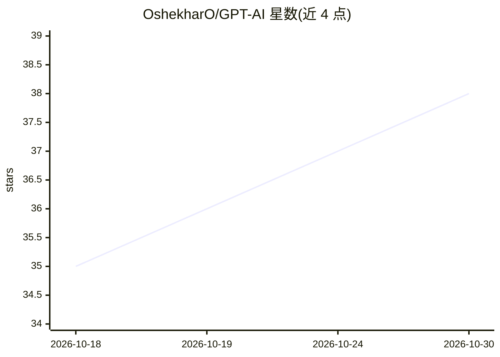

# OshekharO/GPT-AI

⭐ 38 · JavaScript · GPL-3.0 · 推送 2026-09-19 · [GitHub](https://github.com/OshekharO/GPT-AI) · [官网](https://gpt-ai-olive.vercel.app/) · 个人维护

**聚合 15 个免费聊天 API 的 Node.js 统一网关服务器**

基于 Node.js/Express.js 的 API 网关服务器：将 pollinations.ai、OpenRouter、freedomgpt.com 等 15 个上游聊天服务封装为统一的 /chat/v1–v15 POST 端点，请求体只需 userMessage 或 messages 数组，无需自带 API key。内置多轮会话记忆管理：滑动窗口裁剪旧消息、token 估算，并将 system/developer 指令保留在上下文顶部，以避免超出上游限制；启用 CORS 支持网页应用调用。GPL-3.0 开源。README 未给出安装运行命令。

## 筛选速览

| 维度 | 判定 | 备注 |
|---|---|---|
| AI 角色 | `ai-ecosystem` | LLM/agent 周边工具 |
| 许可风险 | `viral` | GPL-3.0 |
| 部署形态 | `None` |  |
| 模型依赖 | — | README 未给出锁定关系 |
| 硬件要求 | — | 无带数字的原话,不猜 |
| 安装摩擦 | `low` | 无编译、无系统依赖或容器化 |
| 成熟度 | — | 结构信号不足 |

## 能力要点

- 15 个上游聊天服务封装为统一 /chat/vN 端点
- 滑动窗口裁剪 + token 估算的多轮会话记忆管理（utils/memory.js）
- 保留 system/developer 指令于上下文顶部
- CORS 启用，网页应用可直接调用

## 适用场景

- 不申请各平台 API key，通过统一接口调用多个聊天模型
- 长多轮对话场景下自动控制上下文长度
- 网页前端直接对接本地部署的聊天网关

## 场景标签

`模型网关` · 领域:Agent 开发

## 证据(README 行号)

> L3: A versatile Node.js server that integrates multiple chatbot APIs, offering a unified interface for various AI conver
> L56: |Endpoint|Backed By|Model / Notes|

## 星数曲线

2026-10-18 35 → 2026-10-30 38（+3）

---
*卡片 v1 · prompt 1.4 · 生成 2026-10-25 · 置信度 high · 依据 README sha `fee171bd950a` · [字段定义](../../DATASET.md)*
