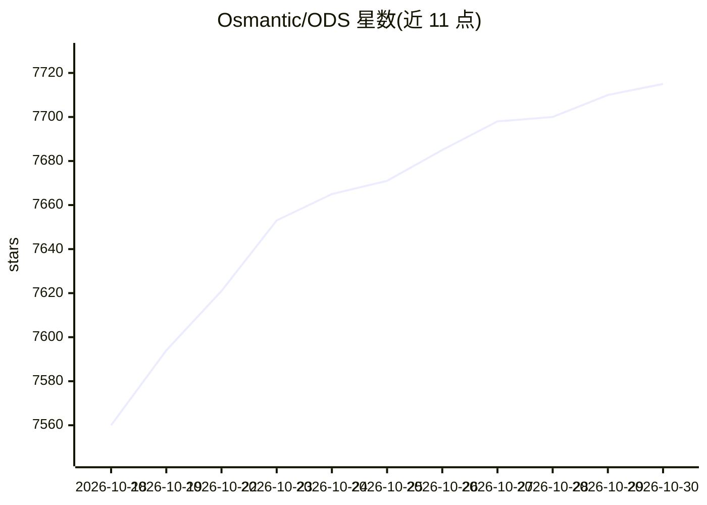

# Osmantic/ODS

⭐ 7,715 · Python · Apache-2.0 · 推送 2026-10-29 · [GitHub](https://github.com/Osmantic/ODS) · [官网](https://discord.gg/qGVygYada3) · 组织维护

**一键把 PC/Mac/Linux 变成私有 AI 服务器的本地部署栈**

面向想在自有硬件上运行私有 AI 的家庭/实验室/工作站用户，ODS 是一个本地 AI 服务器部署系统：通过一条命令的 Linux/macOS 安装脚本或 Windows PowerShell 引导（WSL2/Docker Desktop），自动安装并串联本地推理（Ollama/llama.cpp 类服务）、Open WebUI 聊天界面、控制面板、语音、agents、n8n 工作流、RAG 检索、ComfyUI 图像生成及隐私与运维工具，全程无云、无遥测；云/混合 API 模式（OpenAI/Anthropic/Together）为可选项。当前处于 V3 pre-release 阶段，安装的是未签名的 main 分支，平台支持覆盖 Linux/Windows/macOS Apple Silicon，AMD Strix Halo 与 Intel Arc 各有专门路径或实验层级。

## 筛选速览

| 维度 | 判定 | 备注 |
|---|---|---|
| AI 角色 | `ai-ecosystem` | LLM/agent 周边工具 |
| 许可风险 | `permissive` | Apache-2.0 |
| 部署形态 | `desktop` | 安装包/桌面程序 |
| 模型依赖 | local-ok | 支持本地模型 |
| 硬件要求 | `gpu-8g` | |
| 安装摩擦 | `low` | 无编译、无系统依赖或容器化 |
| 成熟度 | `idea` | |

## 能力要点

- 一条命令安装并串联本地推理、聊天 UI、面板、语音、工作流、RAG 与图像生成全栈
- 默认纯本地运行、无遥测，云/混合 API 模式可选
- Windows PowerShell 引导式 WSL2+Docker 安装，按硬件自动选模型
- 支持 NVIDIA、AMD（Strix Halo/Vulkan llama-server）与 macOS Metal

## 适用场景

- 在家里的工作站上搭建不联网的私有 AI 服务器
- 不想手工组装 Ollama/Open WebUI/n8n/ComfyUI 等十几个服务
- 需要带 RAG、语音和 agent 工作流的完整本地 AI 环境企业内部使用

## 场景标签

`推理引擎` `RAG` `图像生成` `工作流自动化` · 领域:效率与自动化

## 证据(README 行号)

> L23: ODS installs and wires together everything you need to run AI locally, so you do not have to assemble Ollama, Open 
> L137: |**What is it?**|A local AI server stack for your own hardware, with a one-command Linux/macOS installer and a Pow
> L139: |**What do I get?**|Local inference, Open WebUI chat, a control dashboard, voice, agents, workflows, RAG, search, 

## 星数曲线

2026-10-18 7,560 → 2026-10-30 7,715（+155）

---
*卡片 v1 · prompt 1.4 · 生成 2026-10-20 · 置信度 high · 依据 README sha `2ffa891ef291` · [字段定义](../../DATASET.md)*
