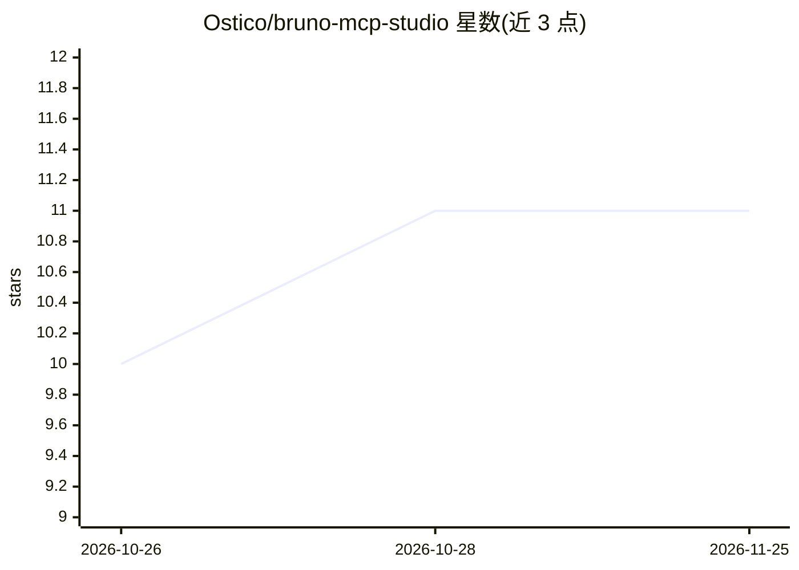

# Ostico/bruno-mcp-studio

⭐ 11 · TypeScript · MIT · 推送 2026-11-20 · [GitHub](https://github.com/Ostico/bruno-mcp-studio) · [官网](https://www.npmjs.com/package/@ostico/bruno-mcp) · 个人维护

**让 AI agent 编写、读取并运行 Bruno API 集合的 MCP 服务器**

独立的 Model Context Protocol 服务器，面向 Bruno API 集合：为 Claude Code、Cursor 等 agent 提供 18 个工具，可创建与部分合并编辑请求、以结构化 JSON 读回、管理环境变量与断言，并以内置管线运行集合（HTTP/WebSocket/gRPC、执行组隔离、cookie、OAuth2/digest），无需 bru CLI。写入与 Bruno 自身格式字节一致，通过 drift gate 用 Bruno 官方 reader 校验。要求 Node.js >= 22。作者同时指出 Bruno 官方团队已于 2026 年 8 月推出官方 MCP 服务器，并给出选型对比表。

## 筛选速览

| 维度 | 判定 | 备注 |
|---|---|---|
| AI 角色 | `ai-ecosystem` | LLM/agent 周边工具 |
| 许可风险 | `permissive` | MIT |
| 部署形态 | `library` | 以包/库形式分发 |
| 模型依赖 | — | README 未给出锁定关系 |
| 硬件要求 | — | 无带数字的原话,不猜 |
| 安装摩擦 | `low` | 无编译、无系统依赖或容器化 |
| 成熟度 | — | 结构信号不足 |

## 能力要点

- 18 个工具覆盖集合编写、读取与运行，支持 .bru 与 .yml 双格式自动检测
- 内置运行管线无需 bru CLI，支持执行组隔离、组内并发与多身份授权测试
- 字节级一致：依赖 Bruno 官方语法包 @usebruno/lang，测试用 Bruno 自身 reader 回读校验
- 产物为标准 Bruno 集合，可在 CI 用 bru run 复跑、团队用 Bruno GUI 打开

## 适用场景

- 让 agent 为真实 API 构建并维护可留存于仓库的测试集合
- 在没有 Bruno GUI/CLI 的环境中由 agent 直接运行集成测试
- 在 CI 中复跑 agent 产出的集合以获得每请求 pass/fail 报告

## 场景标签

 · 领域:开发者工具/API 测试

## 证据(README 行号)

> L13: An independent Model Context Protocol server for
> L27: It gives an AI agent in Claude Code, Claude Desktop, Cursor, Windsurf, VS Code or Codex CLI eighteen tools for API 
> L71: Requires **Node.js >= 22**. CI tests 22.x and 24.x.

## 星数曲线

2026-10-26 10 → 2026-11-25 11（+1）

---
*卡片 v1 · prompt 1.4 · 生成 2026-11-18 · 置信度 high · 依据 README sha `b9dba675a207` · [字段定义](../../DATASET.md)*
