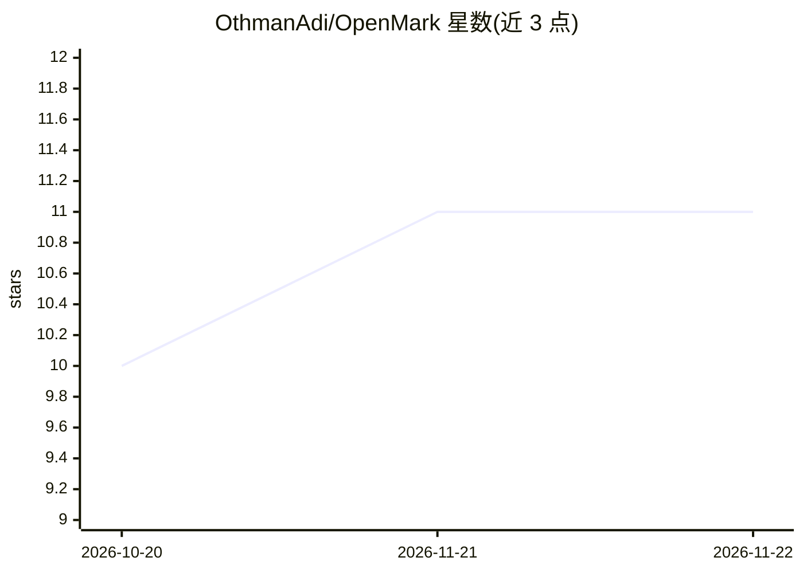

# OthmanAdi/OpenMark

⭐ 11 · Python · MIT · 推送 2026-07-27 · [GitHub](https://github.com/OthmanAdi/OpenMark) · 个人维护

**把书签、LinkedIn 收藏与 YouTube 视频建为个人知识图谱并供 Agent 检索写作**

个人知识管理工具：将 Raindrop/浏览器书签、LinkedIn 收藏、YouTube 视频摄取进 Neo4j 图数据库，用 pplx-embed（本地，约 1.2 GB 下载）或 Azure 嵌入向量化，构建带向量索引、SIMILAR_TO 边与 Louvain 社区的 Graph RAG 存储。其上运行 LangChain v1 编排器，经中间件委派 10 个专职子 Agent 完成检索、多语种撰写、润色与校验，并提供 Gradio UI 与 CLI 搜索。需要 Python 3.13+ 与 Neo4j；v3 已移除 ChromaDB。

## 筛选速览

| 维度 | 判定 | 备注 |
|---|---|---|
| AI 角色 | `ai-native` | 本体是模型或模型工具 |
| 许可风险 | `permissive` | MIT |
| 部署形态 | `library` | 以包/库形式分发 |
| 模型依赖 | local-ok | 支持本地模型 |
| 硬件要求 | — | 无带数字的原话,不猜 |
| 安装摩擦 | `low` | 无编译、无系统依赖或容器化 |
| 成熟度 | — | 结构信号不足 |

## 能力要点

- 书签/LinkedIn/YouTube 摄取至 Neo4j Graph RAG（向量索引 + Louvain 社区）
- 本地 pplx-embed 嵌入（1024 维）或 Azure 嵌入可选
- LangChain v1 编排器 + 10 个 task_* 子 Agent 与 14 个中间件
- Gradio UI（Search/Chat/Graph 3D 等）与 CLI 搜索

## 适用场景

- 把多年收藏的书签和视频建成可语义搜索的第二大脑
- 基于自己收藏的内容生成 LinkedIn 帖、简报与分析文章
- 对个人知识库做多角度深度研究并自动校验

## 场景标签

`知识库管理` `知识图谱` `RAG` `多智能体` · 领域:Agent 开发

## 证据(README 行号)

> L5: **Personal knowledge graph + multi-agent orchestrator for everything you've ever saved.**
> L7: OpenMark ingests bookmarks, LinkedIn saved posts, and YouTube videos into a Neo4j Graph RAG store with semantic embe
> L16: - Runs a single LangChain v1 orchestrator on Azure AI Foundry frontier models (gpt-5.5, gpt-5.3-codex, grok-4.3, cl

## 星数曲线

2026-10-20 10 → 2026-11-22 11（+1）

---
*卡片 v1 · prompt 1.4 · 生成 2026-11-20 · 置信度 high · 依据 README sha `75b74e136a42` · [字段定义](../../DATASET.md)*
