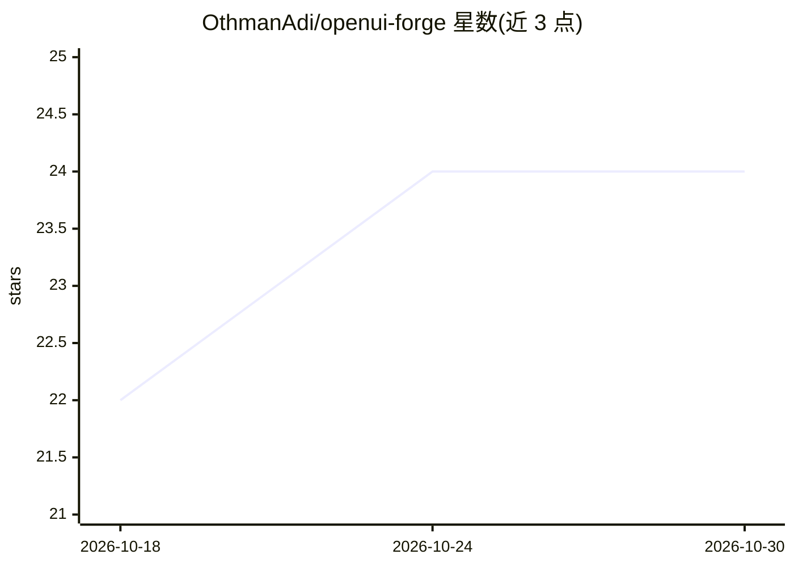

# OthmanAdi/openui-forge

⭐ 24 · PowerShell · MIT · 推送 2026-08-03 · [GitHub](https://github.com/OthmanAdi/openui-forge) · [官网](https://spruce-prism-8yya.here.now/) · 个人维护

**跨 IDE 的 OpenUI 集成技能：向既有项目添加生成式 UI 栈**

面向开发者的 agent 技能包，为 OpenUI（生成式 UI 开放标准，模型输出流式 DSL 而非 JSON/HTML）提供向既有代码库集成、脚手架、组件创建与验证的能力。覆盖 12 种后端栈（TypeScript/Python/Go/Rust/C#/Java/Ruby/PHP/Elixir 等），通过 OPENAI_BASE_URL 路由任意 OpenAI 兼容端点（含 Ollama、LM Studio 本地运行时），并提供 10 步验证流水线。技能内容通过 .agents/skills/ 跨工具标准同步到 Claude Code、Cursor、Gemini CLI 等 11 个 agent 平台。需 Node.js >= 22，React 18.3/19 peer 依赖。

## 筛选速览

| 维度 | 判定 | 备注 |
|---|---|---|
| AI 角色 | `ai-ecosystem` | LLM/agent 周边工具 |
| 许可风险 | `permissive` | MIT |
| 部署形态 | `library` | 以包/库形式分发 |
| 模型依赖 | local-ok | 支持本地模型 |
| 硬件要求 | — | 无带数字的原话,不猜 |
| 安装摩擦 | `low` | 无编译、无系统依赖或容器化 |
| 成熟度 | — | 结构信号不足 |

## 能力要点

- 向既有项目集成 OpenUI（官方 CLI 仅支持全新项目）
- 12 种后端栈模板与对应流式适配器
- OPENAI_BASE_URL 路由任意 OpenAI 兼容端点（含本地 Ollama/LM Studio）
- 10 步验证流水线（依赖/库/提示词/路由/CORS 等）

## 适用场景

- 在非 Next.js 技术栈的现有项目中接入 OpenUI 生成式 UI
- 让 Claude Code/Cursor 等 agent 按技能执行脚手架、集成与验证命令
- 后端用 Python/Go/Rust 等语言对接任意 LLM 供应商输出流式 UI

## 场景标签

`代码生成` · 领域:编码与开发

## 证据(README 行号)

> L21: `openui-forge` is an agent skill that handles the parts the official OpenUI scaffolder doesn't:
> L26: - Mirrors skill content to additional agent platforms beyond Claude Code (Cursor, Gemini CLI, Codex, and more) usin
> L121: `.agents/skills/` is the cross-tool standard directory, and it is the canonical source of truth. `scripts/sync-pla

## 星数曲线

2026-10-18 22 → 2026-10-30 24（+2）

---
*卡片 v1 · prompt 1.4 · 生成 2026-10-27 · 置信度 high · 依据 README sha `1ed01799d3ea` · [字段定义](../../DATASET.md)*
