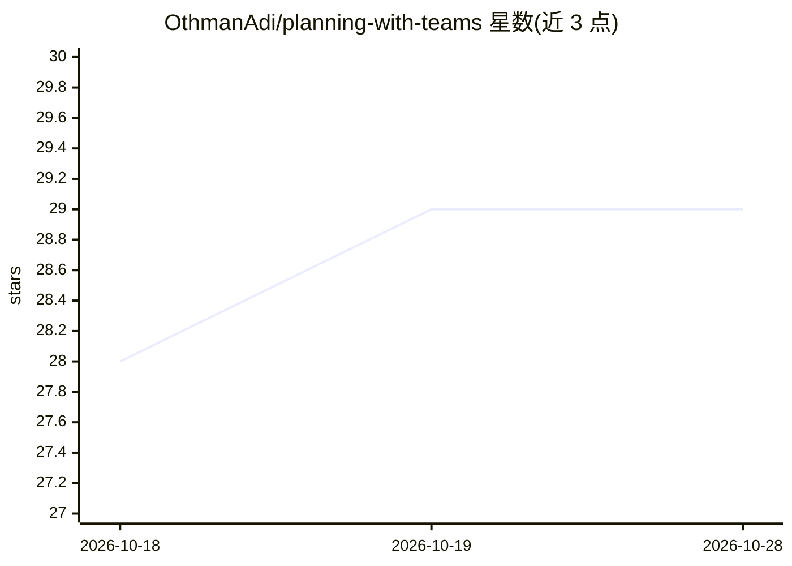

# OthmanAdi/planning-with-teams

⭐ 29 · Python · MIT · 推送 2026-08-03 · [GitHub](https://github.com/OthmanAdi/planning-with-teams) · 个人维护

**Claude Code 多实例协作技能：共享计划文件协调 Agent 团队**

面向 Claude Code Agent Teams 的技能/插件：通过 team_plan.md、team_findings.md、team_progress.md 三个共享文件协调多个 Claude 实例并行工作，采用 Manus 式上下文工程方法（决策前重读计划、即时记录发现、3-Strike 错误协议），并提供 /team、/plan、/status 等斜杠命令。要求 Claude Code 2.1.32+ 并开启实验性 Agent Teams 环境变量；未开启时回退为 Task 子代理模式。也兼容 Cursor、Codex、Gemini CLI 等 40+ 支持 Agent Skills 规范的代理。README 注明 Agent Teams 成本为单代理的 3-5 倍。

## 筛选速览

| 维度 | 判定 | 备注 |
|---|---|---|
| AI 角色 | `ai-ecosystem` | LLM/agent 周边工具 |
| 许可风险 | `permissive` | MIT |
| 部署形态 | `library` | 以包/库形式分发 |
| 模型依赖 | locked-api |  |
| 硬件要求 | — | 无带数字的原话,不猜 |
| 安装摩擦 | `low` | 无编译、无系统依赖或容器化 |
| 成熟度 | `idea` | |

## 能力要点

- 三个共享文件（计划/发现/进度）支撑多实例协调
- 基于原生 Teammate、SendMessage、TaskCreate 工具
- /team、/plan、/status 等命令与 hooks 集成
- Bash、PowerShell、Python 跨平台脚本

## 适用场景

- 并行代码审查（安全+性能+测试分工）
- 多假设并行的 Bug 调查
- 前后端并行的功能开发与大规模重构

## 场景标签

`多智能体` `代码审查` · 领域:Agent 开发

## 证据(README 行号)

> L16: Coordinate multiple Claude Code instances with shared planning files, structured task assignment, and persistent wo
> L75: - **100% Native Agent Teams** — Uses Anthropic's built-in Teammate, SendMessage, TaskCreate tools

## 星数曲线

2026-10-18 28 → 2026-10-28 29（+1）

---
*卡片 v1 · prompt 1.4 · 生成 2026-10-26 · 置信度 high · 依据 README sha `1cd95b1f6f1e` · [字段定义](../../DATASET.md)*
