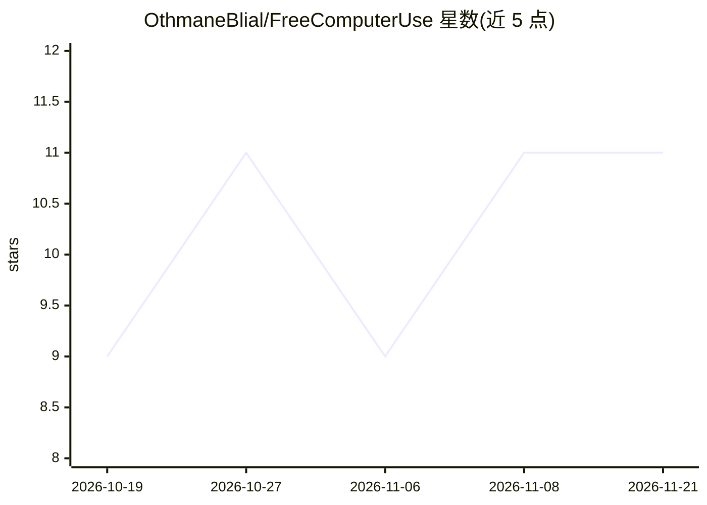

# OthmaneBlial/FreeComputerUse

⭐ 11 · TypeScript · MIT · 推送 2026-10-25 · [GitHub](https://github.com/OthmaneBlial/FreeComputerUse) · [官网](https://othmaneblial.github.io/FreeComputerUse/) · 个人维护

**浏览器自动化 agent：任务教一次，回放零模型调用**

开源浏览器 agent，在本机通过 Playwright 执行操作。用户可给定目标由所选模型规划，或演示一次任务；步骤保存为可版本管理的 procedure，回放时不调用模型，仅当页面变化时让模型修复个别步骤，发布/支付/删除等敏感操作每次都需人工批准。支持 DeepSeek、Anthropic、OpenAI 等多家 API 与订阅登录路线，提供无模型 key 的本地页面读取策略与 MCP 工具接入。Node.js 22.13+ 环境，npm 或源码运行；teach/replay 功能需从源码使用。

## 筛选速览

| 维度 | 判定 | 备注 |
|---|---|---|
| AI 角色 | `ai-native` | 本体是模型或模型工具 |
| 许可风险 | `permissive` | MIT |
| 部署形态 | `library` | 以包/库形式分发 |
| 模型依赖 | locked-api |  |
| 硬件要求 | — | 无带数字的原话,不猜 |
| 安装摩擦 | `low` | 无编译、无系统依赖或容器化 |
| 成熟度 | — | 结构信号不足 |

## 能力要点

- procedure 一次保存、本地回放，重复执行零模型调用
- 页面变化时模型仅修复失败步骤，修复保存为新版本
- 敏感操作每轮人工批准，模型无法执行 shell/任意 JS
- 支持 MCP host 接入四个本地 stdio 工具

## 适用场景

- 把 Google Play 发版等重复流程录制后用不同参数回放
- 让模型规划跨多页面的开放式调查任务
- 通过 MCP host 在本地启动/跟踪/停止浏览器任务

## 场景标签

`浏览器自动化` · 领域:效率与自动化

## 证据(README 行号)

> L16: **Teach it once. Replay it without the model.** FreeComputerUse is an open-source browser agent that runs Playwrigh
> L123: |DeepSeek API|`agent providers set-key deepseek`, or `DEEPSEEK_API_KEY`; default model `deepseek-flash`|Procedure 

## 星数曲线

2026-10-19 9 → 2026-11-21 11（+2）

---
*卡片 v1 · prompt 1.4 · 生成 2026-11-18 · 置信度 high · 依据 README sha `8fbed9880c01` · [字段定义](../../DATASET.md)*
