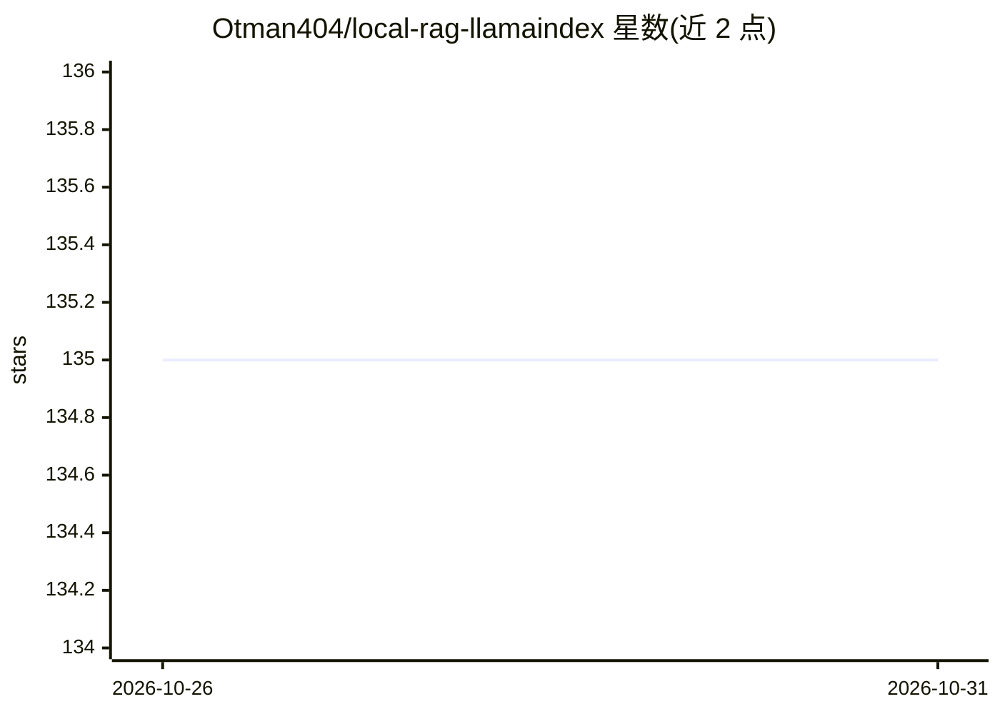

# Otman404/local-rag-llamaindex

⭐ 135 · Python · 推送 2026-10-26 · [GitHub](https://github.com/Otman404/local-rag-llamaindex) · [官网](https://otmaneboughaba.com/posts/local-rag-api/) · 个人维护

**本地离线 RAG 系统：帮研究者从论文集中检索答案**

基于 LlamaIndex + Qdrant + Ollama 的本地 RAG 应用：从 Arxiv 按关键词下载研究论文，用 LlamaIndex 分块、嵌入并存入 Qdrant 向量库；FastAPI 端点接收查询，检索最相关片段后送入本地 LLM（Zephyr 7B Beta GGUF）生成回答，并在响应中返回所依据的论文来源。面向需要离线、零成本查阅论文集的研究者。提供 Docker Compose 一键流程与 uv 手动运行两种方式；需先完成数据摄取再启动 API，CPU 环境下一次查询可能超过一分钟。

## 筛选速览

| 维度 | 判定 | 备注 |
|---|---|---|
| AI 角色 | `ai-native` | 本体是模型或模型工具 |
| 许可风险 | `none` | — |
| 部署形态 | `self-host` | docker 或自建部署 |
| 模型依赖 | local-ok | 支持本地模型 |
| 硬件要求 | — | 无带数字的原话,不猜 |
| 安装摩擦 | `low` | 无编译、无系统依赖或容器化 |
| 成熟度 | — | 结构信号不足 |

## 能力要点

- Arxiv 论文自动下载与 LlamaIndex 索引入库（Qdrant）
- FastAPI 查询端点返回生成答案与来源论文列表
- 全离线运行，LLM 经 Ollama 加载 Zephyr 7B GGUF
- 提供 Docker Compose 与 uv 两种运行方式

## 适用场景

- 搭建本地论文问答系统，离线免费检索研究文献
- 按关键词批量摄取 Arxiv 论文建立个人知识库
- 获得带论文来源引用的生成式回答

## 场景标签

`RAG` `科研工具` · 领域:知识与检索

## 证据(README 行号)

> L5: This project aims to help researchers find answers from a set of research papers with the help of a customized RAG p
> L15: 3. FastAPI endpoint that receives a query/question, searches through our documents and find the best matching chunk
> L17: 5. Generate an easy to understand answer and return it as an API response alongside citing the sources

## 星数曲线

2026-10-26 135 → 2026-10-31 135（+0）

---
*卡片 v1 · prompt 1.4 · 生成 2026-10-27 · 置信度 high · 依据 README sha `04938442288f` · [字段定义](../../DATASET.md)*
