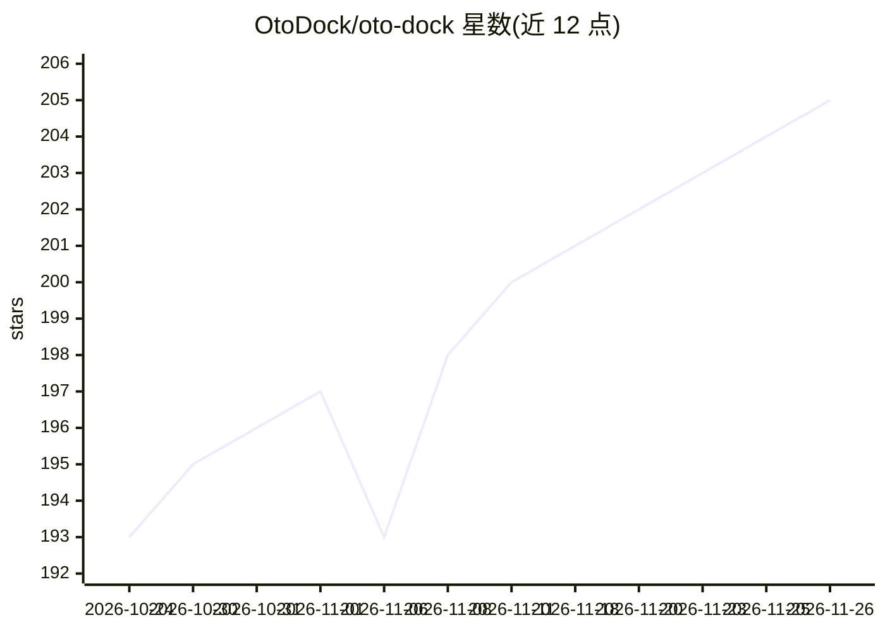

# OtoDock/oto-dock

⭐ 205 · Python · NOASSERTION · 推送 2026-11-21 · [GitHub](https://github.com/OtoDock/oto-dock) · [官网](https://otodock.io) · 组织维护

**企业自托管的 AI agent 运行平台：让团队的 agent 在聊天、定时、电话与自有机器上工作**

自托管的多租户 agent 平台：一台服务器集中管理 agent、成员、文件与密钥，把 Claude Code 与 Codex 会话调度到沙箱化的 compute machine 或配对的远程/个人电脑上运行。agent 支持定时任务、webhook 触发、电话呼入呼出、部门化委派与会议讨论，可构建并部署内部或对外应用。安全方面默认按 agent 不可信设计：内核沙箱、网络隔离、密钥占位符替换、SSO 与按用户成本预算。通过安装脚本以 Docker Compose 部署，含 Android/iOS 客户端。

## 筛选速览

| 维度 | 判定 | 备注 |
|---|---|---|
| AI 角色 | `ai-ecosystem` | LLM/agent 周边工具 |
| 许可风险 | `none` | NOASSERTION |
| 部署形态 | `self-host` | docker 或自建部署 |
| 模型依赖 | local-ok | 支持本地模型 |
| 硬件要求 | — | 无带数字的原话,不猜 |
| 安装摩擦 | `low` | 无编译、无系统依赖或容器化 |
| 成熟度 | — | 结构信号不足 |

## 能力要点

- 多租户四模式共享 agent（个人/工作区组合），每 agent 四级角色权限
- 定时、webhook、电话（Twilio/Asterisk/FreePBX）多入口触达 agent
- agent 会话可跨配对机器迁移并续接上下文，默认沙箱隔离
- 支持 Claude Code/Codex 订阅、API key 与 Ollama 等本地模型引擎

## 适用场景

- 企业内部把 agent 组织成部门并委派协作
- 给客服或预约类业务配一个可接电话的 agent
- 在自有服务器上托管团队 agent 并按人核算成本
- 让 agent 定时巡检并生成报告与通知

## 场景标签

`多智能体` `编码 Agent` `AI 助手` · 领域:Agent 开发

## 证据(README 行号)

> L5:  The self-hosted platform for your company's AI agents.
> L54: and your keys. It runs every Claude Code and Codex session on one of your
> L133: Local models on your own hardware work as well, through Ollama or any

## 星数曲线

2026-10-24 193 → 2026-11-26 205（+12）

---
*卡片 v1 · prompt 1.4 · 生成 2026-11-25 · 置信度 high · 依据 README sha `1af98cea194d` · [字段定义](../../DATASET.md)*
