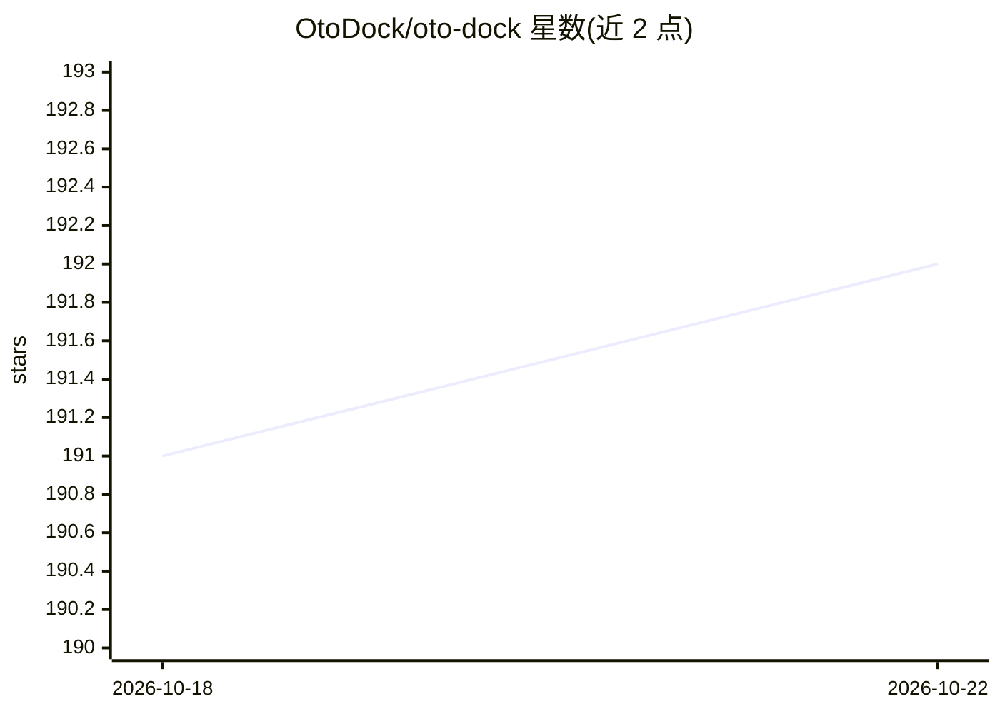

# OtoDock/oto-dock

⭐ 193 · Python · NOASSERTION · 推送 2026-10-14 · [GitHub](https://github.com/OtoDock/oto-dock) · [官网](https://otodock.io) · 组织维护

**企业自托管的 AI agent 协作平台**

面向团队的自托管 agent 平台：在自有服务器上以沙箱方式运行基于 Claude Code、Codex 或本地模型的 agent，提供 Web 仪表盘、定时任务、webhook 触发、电话接入（Twilio/Asterisk）与配对本地机器执行。agent 由 persona、memory、workspace、knowledge、skills、tools 六部分构成，支持多租户、四种共享模式与部门委派；可构建并部署内外部应用。通过安装脚本部署，需 Docker 与至少 4GB 内存的服务器，许可证为 FSL-1.1-ALv2。

## 筛选速览

| 维度 | 判定 | 备注 |
|---|---|---|
| AI 角色 | `ai-ecosystem` | LLM/agent 周边工具 |
| 许可风险 | `none` | NOASSERTION |
| 部署形态 | `None` |  |
| 模型依赖 | local-ok | 支持本地模型 |
| 硬件要求 | — | 无带数字的原话,不猜 |
| 安装摩擦 | `low` | 无编译、无系统依赖或容器化 |
| 成熟度 | — | 结构信号不足 |

## 能力要点

- 沙箱化运行 Claude Code、Codex 或本地模型（Ollama/OpenAI 兼容服务）的 agent
- 定时/webhook 触发任务、电话接入与配对本地机器远程执行
- agent 可构建并部署面向团队或公众的应用
- 内核级沙箱、网络隔离、SSO/2FA 与按用户成本预算

## 适用场景

- 在公司自有服务器上集中运行和管理团队 AI agent
- 让 agent 按计划或在事件触发时自动完成工作并汇报
- 通过电话或配对的本地电脑与 agent 协作

## 场景标签

`多智能体` · 领域:Agent 开发

## 证据(README 行号)

> L5:  The self-hosted platform for your company's AI agents.
> L109: ## Claude Code or Codex on your subscription, or local models.
> L114: through Ollama or any OpenAI-compatible server. You pick the engine per

## 星数曲线

2026-10-18 191 → 2026-10-22 192（+1）

---
*卡片 v1 · prompt 1.4 · 生成 2026-10-22 · 置信度 high · 依据 README sha `0577bd9eda06` · [字段定义](../../DATASET.md)*
