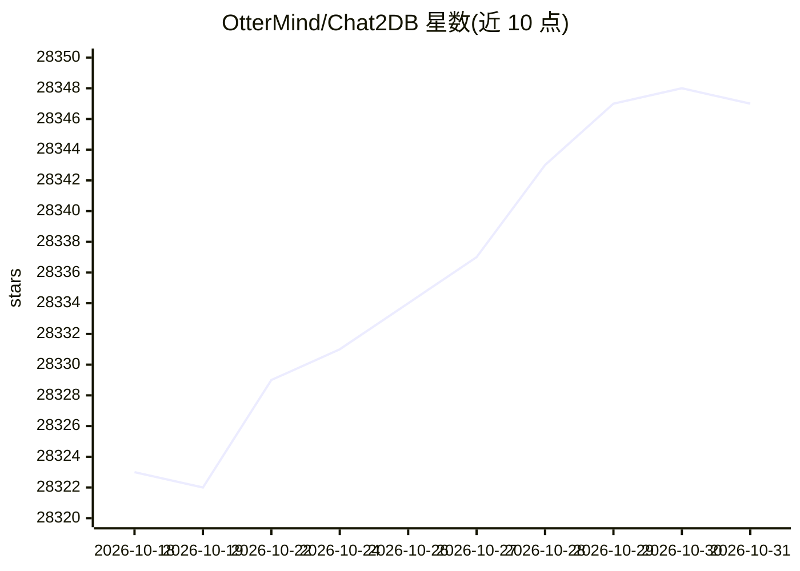

# OtterMind/Chat2DB

⭐ 28,347 · Java · NOASSERTION · 推送 2026-10-29 · [GitHub](https://github.com/OtterMind/Chat2DB) · [官网](https://chat2db.ai) · 组织维护 · 中文 README

**连接 40+ 数据库的本地优先 SQL 客户端，支持自带 AI 模型**

面向开发者、DBA、分析师与数据团队的跨平台数据库客户端与 SQL 工作区，完全运行在本机。支持通过 JDBC 配置接入 40+ 数据库，提供 SQL 编辑、补全、格式化、执行历史、元数据浏览、DDL/DML 管理、数据导入导出、仪表盘与 ER 图。AI 部分采用自带模型（BYOM）方式：用户接入自己的模型来生成、解释和优化 SQL；开源 CLI 提供 MCP 支持。桌面版从 Releases 安装，另提供 Docker/Web 部署与源码构建路径；数据源密码与 AI API key 以 AES-256-GCM 本地加密。

## 筛选速览

| 维度 | 判定 | 备注 |
|---|---|---|
| AI 角色 | `ai-enhanced` | 去掉 AI 部分产品仍成立 |
| 许可风险 | `dual` | NOASSERTION |
| 部署形态 | `self-host` | docker 或自建部署 |
| 模型依赖 | — | README 未给出锁定关系 |
| 硬件要求 | — | 无带数字的原话,不猜 |
| 安装摩擦 | `low` | 无编译、无系统依赖或容器化 |
| 成熟度 | `idea` | |

## 动量与使用信号

- 维护:`active` — 距上次 push 2.0 天,年发版 12,58 位贡献者
- 涨星:近 1 天 **+6**(自 20261016 起算)
- 平台:WINDOWS / MACOS / LINUX · 协议:MCP

## 能力要点

- 40+ 数据库连接，新 JDBC 数据库仅靠配置即可接入
- 自带 AI 模型生成/解释/优化 SQL，开源 CLI 支持 MCP
- AES-256-GCM 本地加密数据源密码与 AI API key
- 桌面、Web/Docker、CLI 多形态分发

## 适用场景

- 在同一工作区管理 MySQL、ClickHouse、MongoDB 等多种数据库
- 用自然语言生成并优化 SQL 查询
- 本地环境可视化浏览数据、绘制仪表盘与 ER 图

## 场景标签

`数据分析` · 领域:效率与自动化

## 证据(README 行号)

> L15: Chat2DB Community is a free, cross-platform database client for Windows, macOS, and Linux. It runs entirely on your
> L19: - **AI assistant** — bring your own AI model to generate, explain, and optimize SQL in natural language.
> L178: The Community edition contains the full local database client described above, including custom AI model support. 

## 星数曲线

2026-10-18 28,323 → 2026-10-31 28,347（+24）

---
*卡片 v1 · prompt 1.4 · 生成 2026-10-18 · 置信度 high · 依据 README sha `f9bb86abbc03` · [字段定义](../../DATASET.md)*
