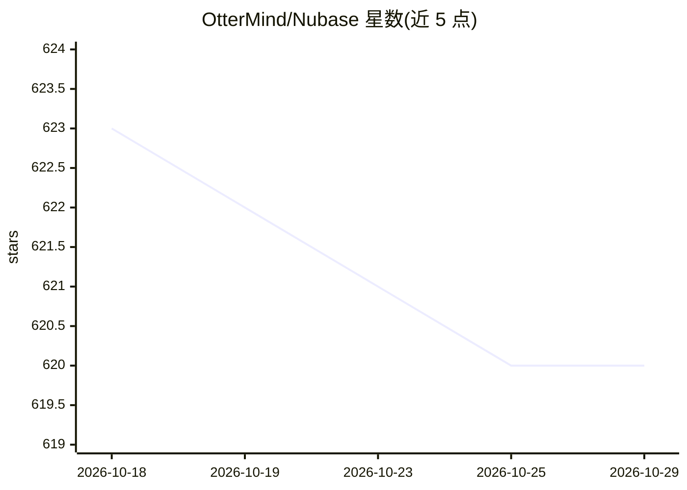

# OtterMind/Nubase

⭐ 620 · Java · Apache-2.0 · 推送 2026-09-28 · [GitHub](https://github.com/OtterMind/Nubase) · [官网](https://nubase.ai) · 组织维护 · 中文 README

**面向 AI 编码 agent 的自托管后端平台，八模块一体**

开源（Apache-2.0）的 AI-native 后端与部署层，供 Claude Code、Codex 等编码 agent 通过 MCP 工具直接驱动。单一 Docker 镜像捆绑 PostgreSQL、Redis、后端与 Studio，提供八大模块：每项目隔离的 Postgres 数据库与 PostgREST 兼容 API、Supabase 风格 Auth、S3 兼容存储、静态 Assets CDN、边缘 Functions、AI Gateway、Mem0 风格 Memory（pgvector 混合检索）与 cron 定时任务。自称与 Supabase 多项目自托管场景对比；README 声明早期阶段，Realtime 与备份/HA 等尚未实现。

## 筛选速览

| 维度 | 判定 | 备注 |
|---|---|---|
| AI 角色 | `ai-ecosystem` | LLM/agent 周边工具 |
| 许可风险 | `permissive` | Apache-2.0 |
| 部署形态 | `self-host` | docker 或自建部署 |
| 模型依赖 | — | README 未给出锁定关系 |
| 硬件要求 | — | 无带数字的原话,不猜 |
| 安装摩擦 | `low` | 无编译、无系统依赖或容器化 |
| 成熟度 | `idea` | |

## 能力要点

- 八模块一体：Database/Auth/Storage/Assets/Functions/AI Gateway/Memory/cron
- MCP 桥（nubase_cli）供编码 agent 建表、部署、发布前端
- 每项目独立 PostgreSQL 数据库与 JWT/RLS 隔离
- 一体化 Docker 镜像（PostgreSQL+Redis+后端+Studio）单行运行

## 适用场景

- 让 Claude Code/Codex 直接生成并部署可上线应用
- 在自有基础设施上隔离运行多个 AI 项目
- 为 agent 应用提供记忆、认证与存储后端

## 场景标签

`Agent 记忆` `模型网关` · 领域:Agent 开发

## 证据(README 行号)

> L21: **Turn AI-written code into real apps.** Nubase is an open-source, AI-native backend **and deploy layer** that a co
> L122: - **🧰 AI Coding & Agents** — an MCP bridge (`nubase_cli`) for schema inspection, SQL execution, RLS export, projec
> L106: Supabase is excellent, but its open-source self-hosted stack is designed around a **single** project. Nubase is bu

## 星数曲线

2026-10-18 623 → 2026-10-29 620（-3）

---
*卡片 v1 · prompt 1.4 · 生成 2026-10-21 · 置信度 high · 依据 README sha `70cb2f38c8f3` · [字段定义](../../DATASET.md)*
