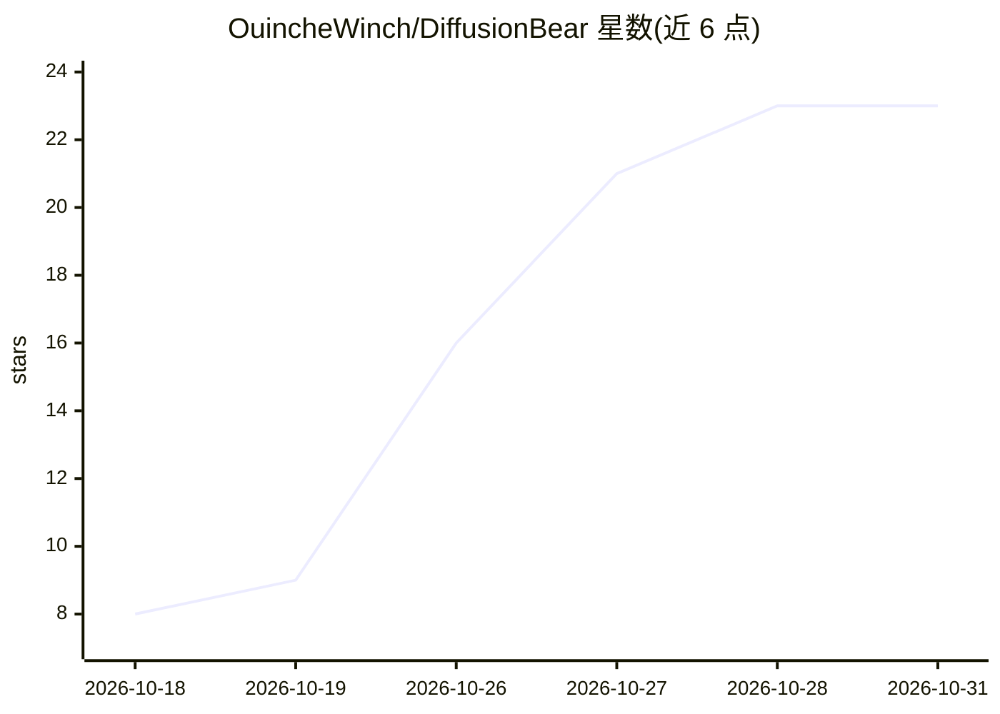

# OuincheWinch/DiffusionBear

⭐ 23 · JavaScript · MIT · 推送 2026-10-30 · [GitHub](https://github.com/OuincheWinch/DiffusionBear) · [官网](https://www.diffusionbear.com/) · 个人维护

**Apple Silicon Mac 本地 AI 图像生成工作室应用**

面向 macOS（Apple Silicon）用户的免费本地图像生成工作室，基于 Apple MLX 框架在 Metal GPU 上运行 SDXL 及其衍生、FLUX.1/2/3、MOSS-Image、Qwen-Image、Krea 2、Z-Image-Turbo、Bria FIBO 2.0 等 12+ 检查点，模型 4-bit 量化并针对 16 GB 统一内存调优，权重首次从 Hugging Face/Civitai 下载后可 100% 离线使用。提供画布 Virtual Boxes 空间布局、参考图编辑、遮罩重绘、LoRA 支持与 Draw Things/DiffusionBee 库只读导入。限制：仅限 Apple Silicon，无 CUDA/CPU 路径，要求 macOS 26.2+。以自包含 .app 安装包分发，无需安装 Python/Xcode。

## 筛选速览

| 维度 | 判定 | 备注 |
|---|---|---|
| AI 角色 | `ai-native` | 本体是模型或模型工具 |
| 许可风险 | `permissive` | MIT |
| 部署形态 | `library` | 以包/库形式分发 |
| 模型依赖 | — | README 未给出锁定关系 |
| 硬件要求 | — | 无带数字的原话,不猜 |
| 安装摩擦 | `medium` | 含编译或系统依赖之一 |
| 成熟度 | `idea` | |

## 能力要点

- 12+ 检查点、8 个模型家族，4-bit 量化适配 16 GB 统一内存
- 画布 Virtual Boxes 空间布局控制（无需 ControlNet）
- 权重首次下载后 100% 离线运行，无账户无云端
- 自包含 .app，捆绑 Python/MLX 运行时，可只读导入 Draw Things/DiffusionBee 模型库

## 适用场景

- 在 Apple Silicon Mac 上离线生成图像，无需云端账户
- 用画布框线精确控制海报排版与主体位置
- 复用已下载的 Civitai SDXL 检查点与 LoRA 本地创作

## 场景标签

`图像生成` · 领域:内容生成

## 证据(README 行号)

> L13: **DiffusionBear** A free macOS studio that runs SDXL (and its derivatives), FLUX.1, FLUX.2 Klein 4B/9B, FLUX.3 Klei
> L16: It is built on Apple's MLX framework, so it is
> L17: **Apple Silicon only**. There is no CUDA or CPU path — MLX is macOS/Metal

## 星数曲线

2026-10-18 8 → 2026-10-31 23（+15）

---
*卡片 v1 · prompt 1.4 · 生成 2026-10-28 · 置信度 mid · 依据 README sha `9ac73efab178` · [字段定义](../../DATASET.md)*
