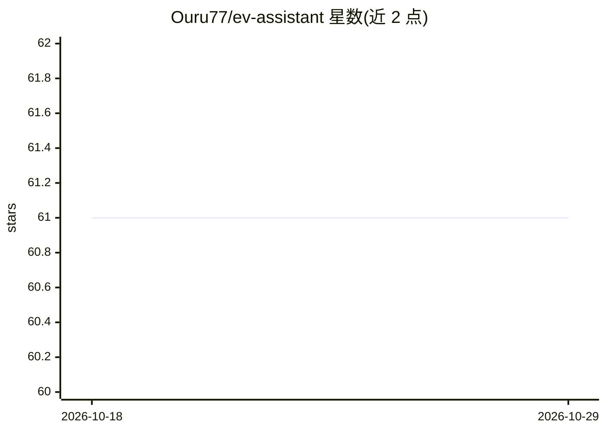

# Ouru77/ev-assistant

⭐ 61 · Python · MIT · 推送 2026-08-10 · [GitHub](https://github.com/Ouru77/ev-assistant) · 个人维护

**本地离线语音助手：Whisper+Ollama 驱动，可控制 PC 并记忆**

面向 Windows 10/11 的桌面语音助手：本地 faster-whisper 做语音识别，Ollama 本地 LLM（默认 gemma2:9b）做对话，浏览器语音或 ElevenLabs 合成回复，全部默认无云、无 API key。支持英语和土耳其语，可执行开/关应用、媒体音量、鼠标点击等 PC 控制（破坏性操作需确认），具备跨会话长期记忆、网页搜索（Playwright）与 Electron 赛博 HUD 界面。屏幕视觉与 Claude 大脑为可选付费项。需 Python 3.10+、Ollama、Node.js，默认模型约需 7-8 GB VRAM，也可换 3B 模型或 CPU 运行。

## 筛选速览

| 维度 | 判定 | 备注 |
|---|---|---|
| AI 角色 | `ai-native` | 本体是模型或模型工具 |
| 许可风险 | `permissive` | MIT |
| 部署形态 | `library` | 以包/库形式分发 |
| 模型依赖 | local-ok | 支持本地模型 |
| 硬件要求 | `gpu-8g` | |
| 安装摩擦 | `low` | 无编译、无系统依赖或容器化 |
| 成熟度 | — | 结构信号不足 |

## 能力要点

- Whisper（CPU）+ Ollama 本地 LLM，默认全程离线、服务器仅绑定 127.0.0.1
- 确定性命令路由器处理 PC 控制，LLM 仅负责聊天与发出 [ACTION] 标签
- 跨会话长期记忆（可记忆/遗忘用户偏好）
- 内置 22 题动作标签准确率评测脚本（temperature 0，可复现）

## 适用场景

- 在本机用语音或文字对话并语音播报回答
- 用语音控制 PC：开关应用、调节音量、锁屏、点按鼠标
- 让助手记住个人偏好供后续会话调用

## 场景标签

`语音 Agent` `AI 助手` · 领域:对话与助手

## 证据(README 行号)

> L17: - 🎙️ **Talk to it** — local **Whisper** speech recognition (offline, free). English or Turkish.
> L18: - 🧠 **Local brain** — a local LLM via **Ollama** (default `gemma2:9b`). Optionally plug in Claude for a smarter bra
> L57: - **LLM:** Ollama (local) or Anthropic Claude (optional)

## 星数曲线

2026-10-18 61 → 2026-10-29 61（+0）

---
*卡片 v1 · prompt 1.4 · 生成 2026-10-24 · 置信度 high · 依据 README sha `e635a34428d0` · [字段定义](../../DATASET.md)*
