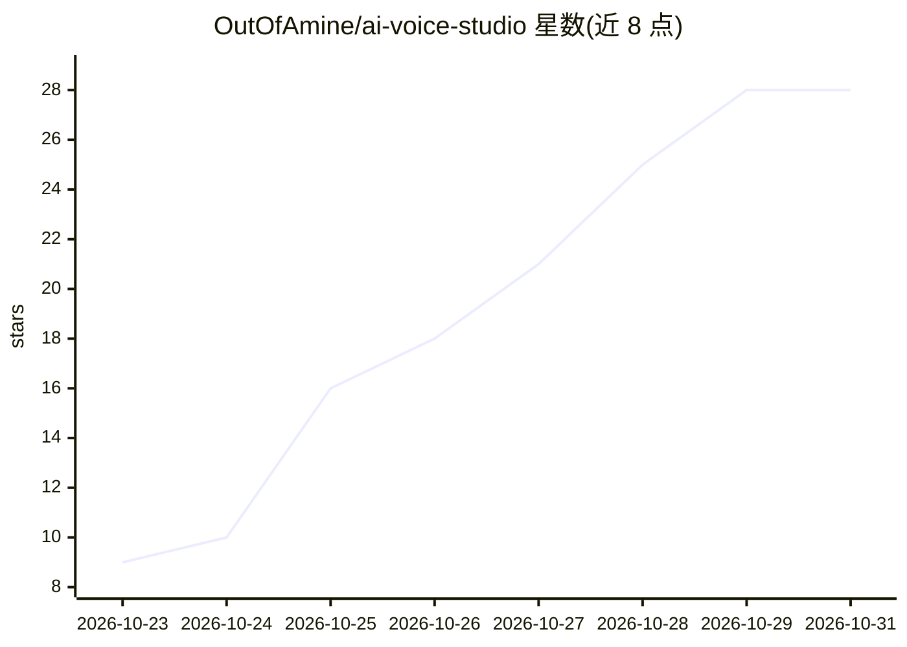

# OutOfAmine/ai-voice-studio

⭐ 28 · Python · MIT · 推送 2026-10-24 · [GitHub](https://github.com/OutOfAmine/ai-voice-studio) · 个人维护

**把手机语音笔记处理成录音棚麦克风音质的本地工具**

面向内容创作者的本地语音修复与母带工具：用 resemble-enhance 去除噪声与房间混响并重建高频，随后进行停顿压缩、广播级 EQ/压缩链，输出响度 -14 LUFS、真峰值 ≤ -1.5 dBTP 的 WAV，符合 Instagram/TikTok 平台响度标准。提供 Gradio Web UI（上传/录音/对比下载）与命令行两种使用方式，支持音视频输入并保留画面换音轨，附带字幕时间映射 JSON。GPU 或 CPU 均可运行，首次运行下载模型权重，Windows 下提供一键启动脚本，另有 Colab/Kaggle 免安装路径。

## 筛选速览

| 维度 | 判定 | 备注 |
|---|---|---|
| AI 角色 | `ai-native` | 本体是模型或模型工具 |
| 许可风险 | `permissive` | MIT |
| 部署形态 | `library` | 以包/库形式分发 |
| 模型依赖 | — | README 未给出锁定关系 |
| 硬件要求 | — | 无带数字的原话,不猜 |
| 安装摩擦 | `medium` | 含编译或系统依赖之一 |
| 成熟度 | — | 结构信号不足 |

## 能力要点

- resemble-enhance 修复 + 停顿压缩 + 广播链 + -14 LUFS 响度输出的流水线
- Gradio Web UI（上传/录音、Strong/Soft 选择、前后对比试听）与 CLI 双入口
- 视频输入输出同画面换音轨，保留口型同步
- 输出 time-map.json 供原字幕重新对时

## 适用场景

- 把手机录的口播语音处理成可发 Instagram/TikTok 的成品音轨
- 播客或短视频创作者在本地免费修复语音、控制平台响度
- 给已剪好的视频直接替换为修复后的声音

## 场景标签

 · 领域:音频处理/内容创作

## 证据(README 行号)

> L55: |1. AI restoration|`1-restored.wav`|resemble-enhance removes noise and room echo and rebuilds the treble lost to ph
> L71: .venv\Scripts\python -m pip install torch torchaudio --index-url https://download.pytorch.org/whl/cu121
> L83: On Windows, double-click **Launch Studio.cmd**. The app opens in your browser.

## 星数曲线

2026-10-23 9 → 2026-10-31 28（+19）

---
*卡片 v1 · prompt 1.4 · 生成 2026-10-28 · 置信度 high · 依据 README sha `7ed2ddeb18e8` · [字段定义](../../DATASET.md)*
