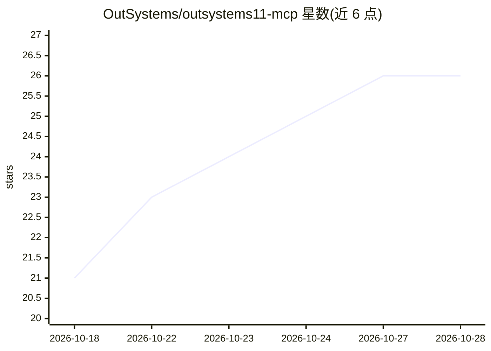

# OutSystems/outsystems11-mcp

⭐ 26 · C# · MIT · 推送 2026-10-13 · [GitHub](https://github.com/OutSystems/outsystems11-mcp) · 组织维护

**让编码 agent 通过 MCP 读写 OutSystems 11 应用的技能包**

OutSystems 官方发布的 MCP 技能仓库：分发 SKILL.md 技能与跨工具 agent 指令，使 Claude Code、GitHub Copilot、Cursor、Kiro、Codex CLI 等编码 agent 通过内嵌于 Service Studio（11.55.91 及以后）的本地 MCP server，经 OutSystems Model API 读取与修改 O11 应用模型。读取能力已 GA，写入能力为 Beta 且每次写入需经 Compare-and-Merge 窗口审查。运行需本机安装 Service Studio 并手动启动 MCP server，安装脚本仅面向 Claude Code，其他工具需手动复制。

## 筛选速览

| 维度 | 判定 | 备注 |
|---|---|---|
| AI 角色 | `ai-ecosystem` | LLM/agent 周边工具 |
| 许可风险 | `permissive` | MIT |
| 部署形态 | `None` |  |
| 模型依赖 | locked-api |  |
| 硬件要求 | — | 无带数字的原话,不猜 |
| 安装摩擦 | `low` | 无编译、无系统依赖或容器化 |
| 成熟度 | `idea` | |

## 能力要点

- 通过 Service Studio 内嵌本地 MCP server 读写 O11 应用模型
- 读取能力 GA，写入能力 Beta 且经 Compare-and-Merge 审查
- SKILL.md/AGENTS.md 跨工具标准，支持 Claude Code、Copilot、Cursor、Kiro、Codex 等
- 本地运行，支持 on-premises 与 air-gapped 环境

## 适用场景

- 让编码 agent 分析、梳理现有 OutSystems 11 模块结构与依赖
- 通过 agent 生成模块文档、发现死代码与安全风险
- 在 O11 生命周期治理下用 agent 新建或修改实体、屏幕与动作

## 场景标签

`编码 Agent` · 领域:编码与开发

## 证据(README 行号)

> L5: OutSystems 11 is the stable, trusted foundation your core operations run on. The OutSystems 11 MCP lets you moderniz
> L20: |**Tool**|A local MCP server, embedded in Service Studio (11.55.91 and later) — the entry point for your agent.|
> L22: |**Reach**|Any MCP-compatible agent; optimized today for Claude Code, and packaged for GitHub Copilot (CLI and VS C

## 星数曲线

2026-10-18 21 → 2026-10-28 26（+5）

---
*卡片 v1 · prompt 1.4 · 生成 2026-10-27 · 置信度 high · 依据 README sha `51763bd2398d` · [字段定义](../../DATASET.md)*
