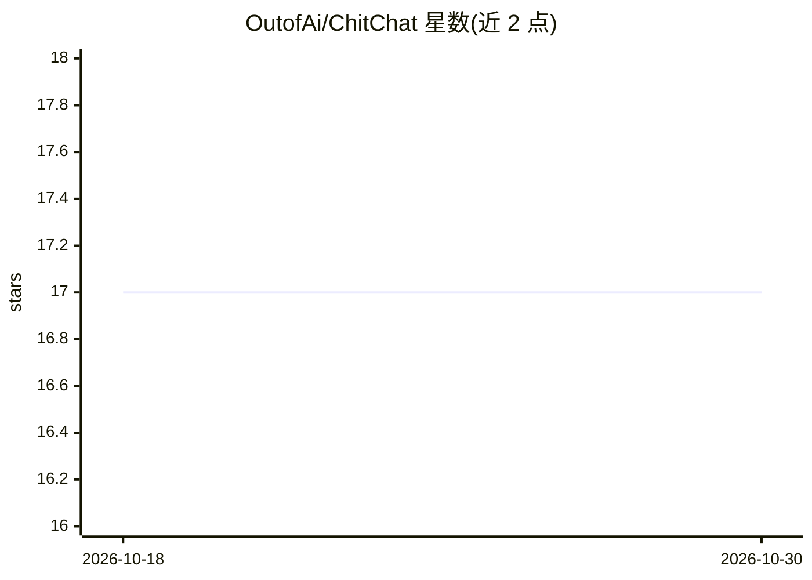

# OutofAi/ChitChat

⭐ 17 · Python · MIT · 推送 2026-03-23 · [GitHub](https://github.com/OutofAi/ChitChat) · 个人维护

**将 Mistral 7B GGUF 以 Modal serverless 部署为推理 API 的模板**

Model as a Service (MaaS) 模板系列的第一部分，演示用少量代码在 Modal 上部署 Mistral 7B Instruct v0.1 (GGUF)，通过 llama.cpp 支持的任意模型均可替换。提供 CPU 与 GPU (T4) 两个部署脚本，运行 modal deploy 命令即生成推理端点 API；配套 Web 页面可填入端点链接执行推理，也可对接本地 FastAPI 端点。使用需先注册 Modal 账号并安装 modal Python 包。

## 筛选速览

| 维度 | 判定 | 备注 |
|---|---|---|
| AI 角色 | `ai-ecosystem` | LLM/agent 周边工具 |
| 许可风险 | `permissive` | MIT |
| 部署形态 | `library` | 以包/库形式分发 |
| 模型依赖 | local-ok | 支持本地模型 |
| 硬件要求 | — | 无带数字的原话,不猜 |
| 安装摩擦 | `low` | 无编译、无系统依赖或容器化 |
| 成熟度 | — | 结构信号不足 |

## 能力要点

- 少量代码将 Mistral 7B GGUF 部署为 Modal 推理端点
- 提供 CPU 与 GPU (T4) 两种部署示例
- 可替换为 llama.cpp 支持的任意模型
- 配套网页端点执行推理，兼容本地 FastAPI 端点

## 适用场景

- 快速把 GGUF 模型发布为 serverless 推理 API
- 低成本试用 Modal 部署 LLM 的流程
- 为聊天网页接入自建推理端点

## 场景标签

`推理引擎` · 领域:训练与推理

## 证据(README 行号)

> L7:  This is the first part of a collection of templates we are working on for promoting the concept of Model as a Seriv
> L19:  There are two examples avaiable here and depending on cost you can choose which one you like to deploy. We recomme

## 星数曲线

2026-10-18 17 → 2026-10-30 17（+0）

---
*卡片 v1 · prompt 1.4 · 生成 2026-10-30 · 置信度 high · 依据 README sha `9801f3bc4a61` · [字段定义](../../DATASET.md)*
