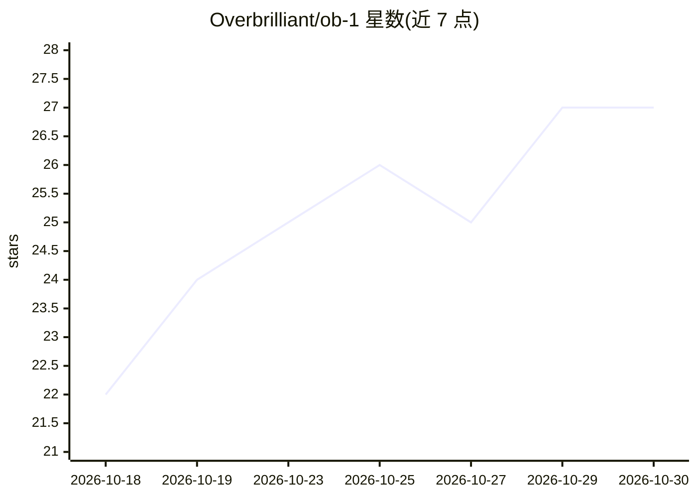

# Overbrilliant/ob-1

⭐ 27 · TypeScript · Apache-2.0 · 推送 2026-10-26 · [GitHub](https://github.com/Overbrilliant/ob-1) · [官网](https://overbrilliant.com) · 个人维护

**免账号免 API key 的终端编码 agent，并行子代理与自我纠错**

面向开发者的开源 CLI 编码 agent（Apache-2.0）：在仓库中运行后读取代码库、构建仓库地图、编辑文件、运行检查并维护可检视的持久项目记忆（SQLite+图）。机制上把独立子任务分发给隔离的只读子代理，困难变更升级到 Fusion 生成 N 个候选并按用户真实检查选择，默认最多三轮自我纠错且自修复循环禁止编辑测试文件。默认路径通过内嵌的免费模型路由器免账号免 key 启动，也可接入自有 provider key 或本地模型；提供 macOS/Linux 原生包、Homebrew、npm（需 Bun 运行时）与源码安装。自述为早期公开软件，1.0 前接口可能变化。

## 筛选速览

| 维度 | 判定 | 备注 |
|---|---|---|
| AI 角色 | `ai-native` | 本体是模型或模型工具 |
| 许可风险 | `permissive` | Apache-2.0 |
| 部署形态 | `library` | 以包/库形式分发 |
| 模型依赖 | local-ok | 支持本地模型 |
| 硬件要求 | — | 无带数字的原话,不猜 |
| 安装摩擦 | `low` | 无编译、无系统依赖或容器化 |
| 成熟度 | `idea` | |

## 能力要点

- 内嵌免费模型路由器：无账号、无卡、无 API key 即可启动
- 并行只读子代理 + Fusion best-of-N 候选生成与检查选择
- 持久项目记忆（事实、关系、图）可在会话间检视
- 自修复循环拒绝编辑测试文件（test pattern 路径拒绝并记录）

## 适用场景

- 在终端让 agent 读仓库、改代码并跑到检查通过
- 不注册账号、不配 API key 直接试用免费模型的编码 agent
- 接入自有 OpenAI 兼容端点或 Ollama/vLLM 本地模型做编码任务

## 场景标签

`编码 Agent` · 领域:编码与开发

## 证据(README 行号)

> L33: OB-1 is a free, open-source CLI coding agent built around parallel work: it fans independent
> L41: The default path is free out of the box: OB-1 has an embedded free-models router built into the CLI

## 星数曲线

2026-10-18 22 → 2026-10-30 27（+5）

---
*卡片 v1 · prompt 1.4 · 生成 2026-10-26 · 置信度 high · 依据 README sha `f2f55e44d66b` · [字段定义](../../DATASET.md)*
