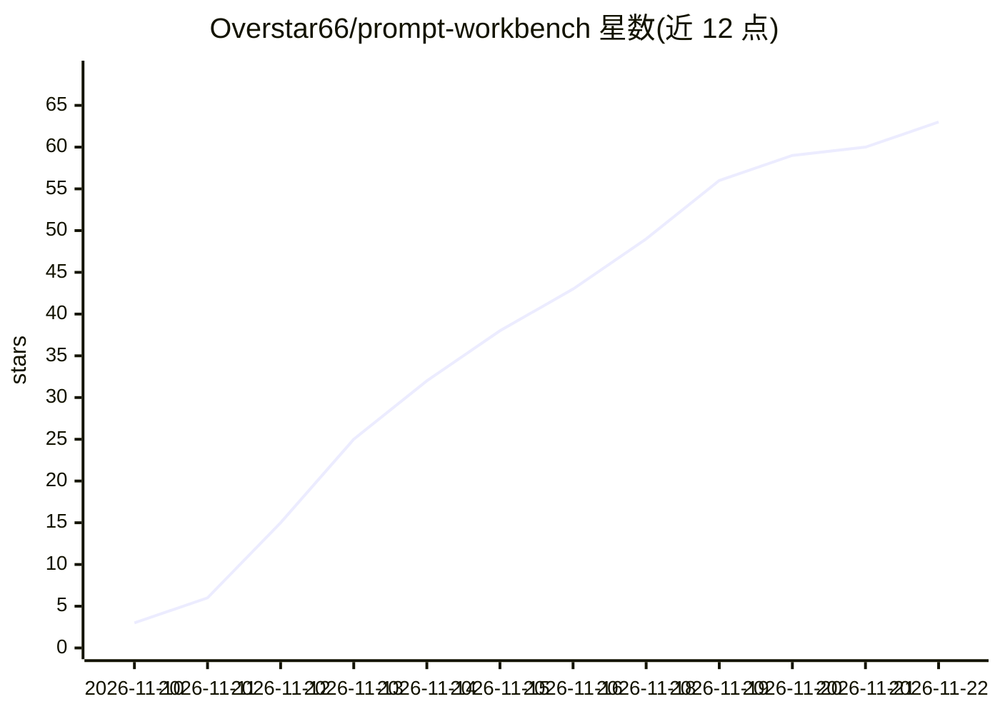

# Overstar66/prompt-workbench

⭐ 63 · Python · MIT · 推送 2026-11-12 · [GitHub](https://github.com/Overstar66/prompt-workbench) · 个人维护 · 中文 README

**本地动漫提示词工作台：图反推、AI 扩写、标签拼装**

面向 Stable Diffusion / Illustrious / Pony 系模型使用者的本地 Web 工具：通过 WD14 ONNX 模型对拖入图片反推标签，或用几句中文经 DeepSeek API / 本地 Ollama 扩写成分镜，再结合内置 18000+ 词条词库拆分标签、补全角色外观，一键生成 MOSS / WAI / Pony 三套正向与负向提示词。后端仅用 Python 标准库、单文件、无数据库，词库匹配与拼装全在本地完成。限制：单进程无鉴权仅监听本机，内置成人向词库限 18+，本地扩写质量取决于 Ollama 模型规模。

## 筛选速览

| 维度 | 判定 | 备注 |
|---|---|---|
| AI 角色 | `ai-native` | 本体是模型或模型工具 |
| 许可风险 | `permissive` | MIT |
| 部署形态 | `library` | 以包/库形式分发 |
| 模型依赖 | local-ok | 支持本地模型 |
| 硬件要求 | — | 无带数字的原话,不猜 |
| 安装摩擦 | `low` | 无编译、无系统依赖或容器化 |
| 成熟度 | — | 结构信号不足 |

## 能力要点

- WD14 图反推标签 + 中文描述（onnxruntime 可选依赖）
- 18000+ 词条词库、2900+ 角色、50 画风库，含角色外观自动补全
- MOSS / WAI / Pony 三套正负向提示词一键生成与负向自适应
- 后端纯标准库单文件，支持纯本地 / 纯 API / 混合三种模式

## 适用场景

- 为 Illustrious / Pony 系模型快速拼装可直接粘贴的提示词
- 从参考图反推标签并继续编辑成完整提示词
- 离线环境下用本地 Ollama 扩写中文分镜描述

## 场景标签

`提示工程` · 领域:Agent 开发

## 证据(README 行号)

> L3: 本地运行的动漫插画**提示词工作台**：拖图反推 / 中文扩写 → 拆标签 → 一键生成 MOSS、WAI、Pony 全套正向与负向。
> L15: - 三种输入：拖一张图（WD14 反推）、写几句中文（AI 扩写）、从词库点选。
> L89: |图反推|WD14 打标 → 标签自动进入「已选」，并给一段中文描述（需可选依赖）|

## 星数曲线

2026-11-10 3 → 2026-11-22 63（+60）

---
*卡片 v1 · prompt 1.4 · 生成 2026-11-18 · 置信度 mid · 依据 README sha `2b74c5db6c2a` · [字段定义](../../DATASET.md)*
