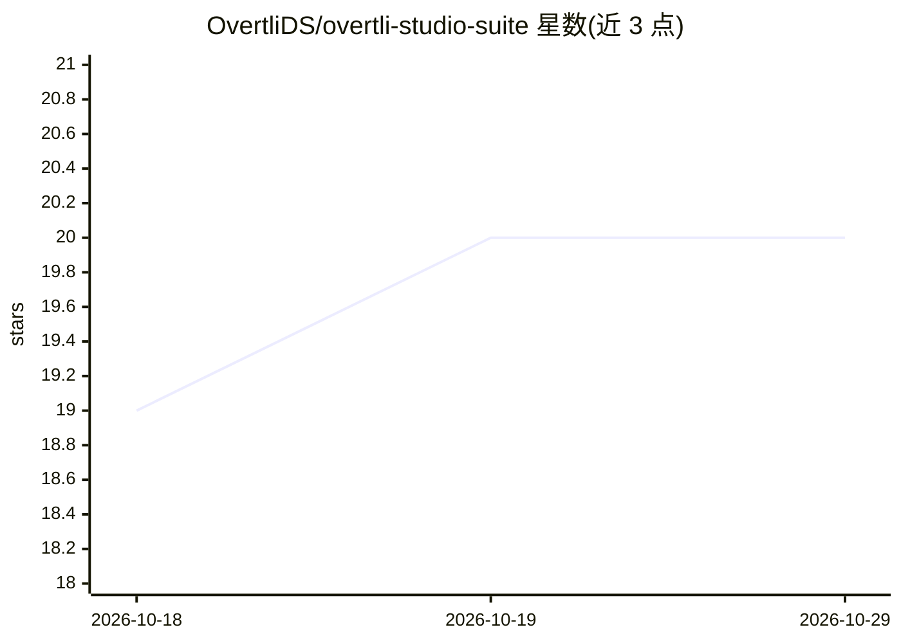

# OvertliDS/overtli-studio-suite

⭐ 20 · Python · MIT · 推送 2026-10-01 · [GitHub](https://github.com/OvertliDS/overtli-studio-suite) · 个人维护

**ComfyUI 多引擎 AI 生成节点套件：统一路由本地/云端提示词与媒体生成**

Windows 优先的 ComfyUI 自定义节点套件，通过统一的高级路由节点（GZ_AdvancedTextEnhancer）管理多引擎工作流，覆盖提示词增强、文本、图像、视频、语音、音乐生成与语音转录。接入 Pollinations.ai（云端）、LM Studio 与 Ollama（本地）、GitHub Copilot CLI、以及任意 OpenAI 兼容 API（如 Groq、Together AI）。提供 63 个指令预设与 656 个内置样式预设，可作为现有工作流的插入式提示词增强器使用，无需重构图谱。安装方式为 git clone 到 custom_nodes 目录并 pip 安装依赖。

## 筛选速览

| 维度 | 判定 | 备注 |
|---|---|---|
| AI 角色 | `ai-ecosystem` | LLM/agent 周边工具 |
| 许可风险 | `permissive` | MIT |
| 部署形态 | `library` | 以包/库形式分发 |
| 模型依赖 | local-ok | 支持本地模型 |
| 硬件要求 | — | 无带数字的原话,不猜 |
| 安装摩擦 | `low` | 无编译、无系统依赖或容器化 |
| 成熟度 | — | 结构信号不足 |

## 能力要点

- 统一路由节点覆盖 text/image/video/TTS/STT/音乐 六类引擎
- Pollinations/LM Studio/Ollama/Copilot CLI/OpenAI 兼容 API 多提供商接入
- 63 个指令预设与 656 个内置样式预设
- 可作为现有 CLIP Text Encode 工作流的插入式提示词增强器

## 适用场景

- 在 ComfyUI 中用本地或云端模型增强/重写提示词
- 在同一工作流内切换多种生成引擎与模态
- 为 Flux 等 diffusion 工作流添加多引擎媒体生成节点

## 场景标签

`模型网关` `提示工程` `图像生成` `语音合成` · 领域:Agent 开发

## 证据(README 行号)

> L5: **Windows-first ComfyUI custom nodes for local and cloud AI generation, featuring a unified advanced router for seam
> L94: |⚡ **`GZ_AdvancedTextEnhancer`**|**(Recommended)** Unified provider/engine router.|Provider-aware engine routing: `
> L102: |🖥️ **`GZ_LLMTextEnhancer`**|**(Recommended for local)** Local/OpenAI-compatible text+vision route (LM Studio, Oll

## 星数曲线

2026-10-18 19 → 2026-10-29 20（+1）

---
*卡片 v1 · prompt 1.4 · 生成 2026-10-28 · 置信度 high · 依据 README sha `a9060596bca5` · [字段定义](../../DATASET.md)*
