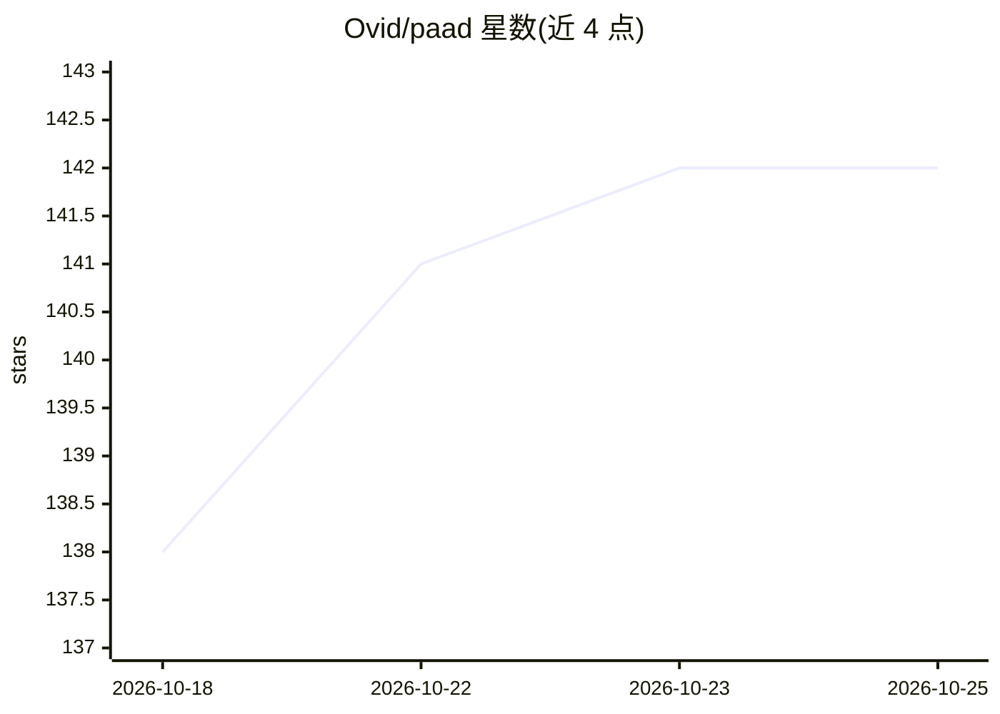

# Ovid/paad

⭐ 144 · Python · MIT · 推送 2026-10-25 · [GitHub](https://github.com/Ovid/paad) · [官网](https://curtispoe.org/paad/) · 个人维护

**面向 AI 编程助手的工程化技能集：规范质疑、对齐、架构与代码评审**

PAAD（Pushback, Alignment, Architecture, Discipline）是一组可装入 AI 编程 agent 的技能/斜杠命令：在编码前对规范与任务清单提出质疑（pushback）、核对计划与规范一致性（alignment）、以多专家子代理执行合并前代码评审（agentic-review）与架构债务扫描（agentic-architecture），另有 a11y 审计、测试路线图等技能。原生支持 Claude Code 插件市场安装，也可通过 npx skills 安装到 70 余种其他 agent。README 声明结果非确定性、不替代人工评审。

## 筛选速览

| 维度 | 判定 | 备注 |
|---|---|---|
| AI 角色 | `ai-ecosystem` | LLM/agent 周边工具 |
| 许可风险 | `permissive` | MIT |
| 部署形态 | `library` | 以包/库形式分发 |
| 模型依赖 | locked-api |  |
| 硬件要求 | — | 无带数字的原话,不猜 |
| 安装摩擦 | `low` | 无编译、无系统依赖或容器化 |
| 成熟度 | `idea` | |

## 能力要点

- 12 个常规技能 + 4 个实验技能，覆盖规范、计划、代码、架构各阶段评审
- agentic-review 以六名专家子代理审查分支，agentic-architecture 以五名专家扫描结构性债务
- Claude Code 原生插件安装，npx 一条命令装入 70+ 其他 agent
- 支持按项目配置文件（paad/config/*.md）定制技能行为

## 适用场景

- 让 AI 编程助手在写码前先质疑我的规范和任务清单
- 合并前对分支做多专家代码评审
- 扫描并逐项偿还项目结构性技术债

## 场景标签

`代码审查` `提示工程` · 领域:Agent 开发

## 证据(README 行号)

> L12: **PAAD** (rhymes with "pad") is a set of skills that let you write
> L126: PAAD supports **Claude Code** natively, installs into 70+ other agents with one

## 星数曲线

2026-10-18 138 → 2026-10-25 142（+4）

---
*卡片 v1 · prompt 1.4 · 生成 2026-10-22 · 置信度 high · 依据 README sha `c5a7aa048fb7` · [字段定义](../../DATASET.md)*
