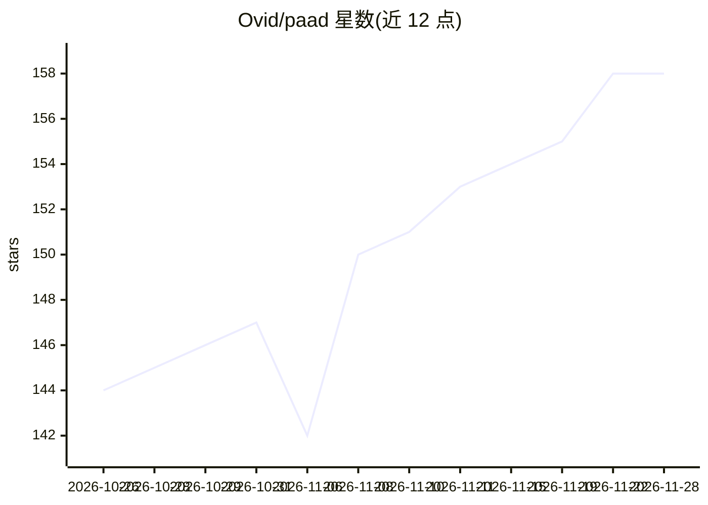

# Ovid/paad

⭐ 158 · Python · MIT · 推送 2026-11-27 · [GitHub](https://github.com/Ovid/paad) · [官网](https://curtispoe.org/paad/) · 个人维护

**给 AI 辅助开发者提供规范化代码评审与架构审查的技能集**

PAAD 是一组可安装到 Claude Code 等 coding agent 的技能（skills），围绕 Pushback、Alignment、Architecture、Discipline 四个环节，在 spec、任务列表、架构与代码等阶段生成评审结论：包括对 spec 的质疑、计划与规格一致性检查、六角色分支审查、结构性债务发现、WCAG 2.2 AA 无障碍审计、测试路线图构建等 12+ 个斜杠命令。支持按项目的配置文件定制各技能行为，2.0.0 起提供配置文件并将安全发现排除在提交报告之外。要求使用者自行判断各项发现，结果为非确定性输出。

## 筛选速览

| 维度 | 判定 | 备注 |
|---|---|---|
| AI 角色 | `ai-native` | 本体是模型或模型工具 |
| 许可风险 | `permissive` | MIT |
| 部署形态 | `library` | 以包/库形式分发 |
| 模型依赖 | — | README 未给出锁定关系 |
| 硬件要求 | — | 无带数字的原话,不猜 |
| 安装摩擦 | `low` | 无编译、无系统依赖或容器化 |
| 成熟度 | — | 结构信号不足 |

## 能力要点

- 12+ 个斜杠命令技能：pushback、alignment、agentic-review、agentic-architecture 等
- 原生支持 Claude Code，一条 npx 命令安装到 70+ 其他 agent
- paad/config/ 下的配置文件可按项目定制技能行为
- 按四阶段（spec/任务/架构/代码）分别提供评审技能

## 适用场景

- 在合并前对 AI 生成的分支运行多角色代码审查
- 让 AI 质疑并完善我写的 spec 和任务列表
- 发现项目中的结构性技术债务并逐项修复
- 按 WCAG 2.2 AA 对 UI 改动做无障碍审计

## 场景标签

`代码审查` · 领域:编码与开发

## 证据(README 行号)

> L12: **PAAD** (rhymes with "pad") is a set of skills that let you write
> L59: |Skill|What it does|
> L136: PAAD supports **Claude Code** natively, installs into 70+ other agents with one

## 星数曲线

2026-10-26 144 → 2026-11-28 158（+14）

---
*卡片 v1 · prompt 1.4 · 生成 2026-11-27 · 置信度 high · 依据 README sha `584e399f2f23` · [字段定义](../../DATASET.md)*
