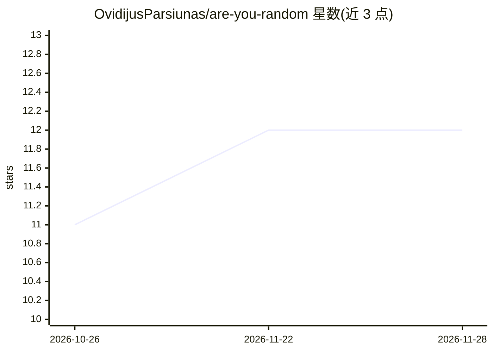

# OvidijusParsiunas/are-you-random

⭐ 12 · TypeScript · 推送 2026-09-19 · [GitHub](https://github.com/OvidijusParsiunas/are-you-random) · [官网](https://ovidijusparsiunas.github.io/are-you-random/) · 个人维护

**浏览器小游戏：用模式识别预测你的“随机”选择**

网页版预测游戏：玩家在 2-6 个选项中做选择，机器通过 Markov Chain 与 TensorFlow.js 神经网络学习行为模式并预测下一步，猜对得分。项目目标是展示人类选择并不如想象中随机。提供线上页面直接游玩，开发时经 npm 安装并启动本地开发服务。灵感来自 mav vs machine 项目，接受社区贡献与 issue 反馈。

## 筛选速览

| 维度 | 判定 | 备注 |
|---|---|---|
| AI 角色 | `ai-native` | 本体是模型或模型工具 |
| 许可风险 | `none` | — |
| 部署形态 | `library` | 以包/库形式分发 |
| 模型依赖 | — | README 未给出锁定关系 |
| 硬件要求 | — | 无带数字的原话,不猜 |
| 安装摩擦 | `low` | 无编译、无系统依赖或容器化 |
| 成熟度 | — | 结构信号不足 |

## 能力要点

- Markov Chain 基于近期选择模式进行预测
- TensorFlow.js 神经网络学习玩家行为
- GitHub Pages 提供在线游玩页面

## 适用场景

- 在线体验“人是否真的随机”的预测游戏
- 本地运行学习 Markov 链与神经网络的预测实现
- 向他人演示人类行为中的模式

## 场景标签

 · 领域:游戏/演示

## 证据(README 行号)

> L5: A browser game that tests how predictable your "random" choices really are.
> L24: - **Markov Chain** - Predicts based on patterns in your recent choices
> L25: - **Neural Network** - A TensorFlow.js model that learns your behavior

## 星数曲线

2026-10-26 11 → 2026-11-28 12（+1）

---
*卡片 v1 · prompt 1.4 · 生成 2026-11-18 · 置信度 high · 依据 README sha `34a8abe68fb7` · [字段定义](../../DATASET.md)*
