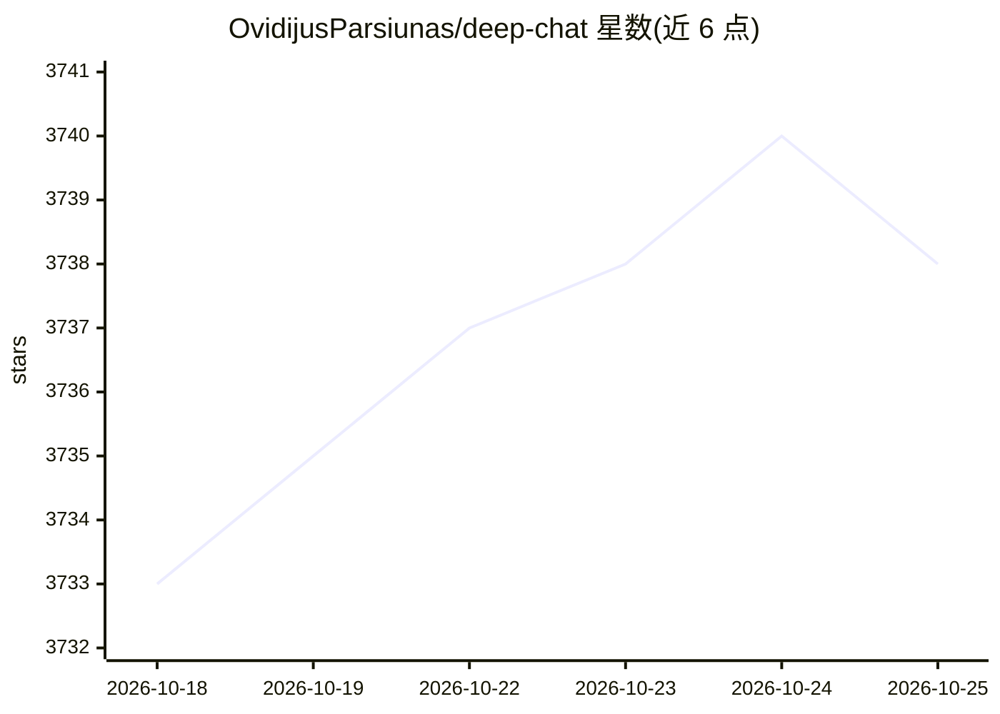

# OvidijusParsiunas/deep-chat

⭐ 3,738 · TypeScript · MIT · 推送 2026-10-24 · [GitHub](https://github.com/OvidijusParsiunas/deep-chat) · [官网](https://deepchat.dev) · 个人维护

**可嵌入网站的可定制 AI 聊天组件，一行代码接入**

面向 Web 开发者的 AI 聊天 UI 组件库：通过 npm 安装后以一行标签嵌入网站，支持 React、Vue、Angular、Svelte 等主流框架。可直接从浏览器连接 20 余种 AI API（如 OpenAI、Claude），也可经自定义服务或代理接入；支持文件收发、摄像头拍照、麦克风录音、语音转文字/文字转语音、浏览器本地运行 LLM（webModel）。限制：浏览器直连方式会暴露 API Key，官方建议仅用于本地/原型/演示，正式上线需切换代理服务。提供多框架示例、服务器模板与在线 Playground。

## 筛选速览

| 维度 | 判定 | 备注 |
|---|---|---|
| AI 角色 | `ai-ecosystem` | LLM/agent 周边工具 |
| 许可风险 | `permissive` | MIT |
| 部署形态 | `library` | 以包/库形式分发 |
| 模型依赖 | locked-api |  |
| 硬件要求 | — | 无带数字的原话,不猜 |
| 安装摩擦 | `low` | 无编译、无系统依赖或容器化 |
| 成熟度 | — | 结构信号不足 |

## 能力要点

- 一行代码将聊天组件嵌入网站
- directConnection 直连 20+ AI API（含 OpenAI、Claude、Requesty、liteLLM、Dify、Open WebUI）
- webModel 搭配 deep-chat-web-llm 在浏览器内本地运行 LLM
- 支持文件收发、摄像头/麦克风采集、语音转文字与文字转语音

## 适用场景

- 为自己的网站快速添加可定制的 AI 聊天界面
- 在 React/Vue/Angular 等框架中集成统一的聊天组件
- 无需后端在浏览器本地运行 LLM 做原型演示

## 场景标签

`聊天机器人` · 领域:对话与助手

## 证据(README 行号)

> L3:  Deep Chat is a fully customizable AI chat component that can be injected into your website with just _one line of c
> L18: - Connect to more than 20 popular AI APIs such as OpenAI or Claude directly from the browser
> L122: Connect to popular AI APIs directly from the browser via the use of the `directConnection` property:

## 星数曲线

2026-10-18 3,733 → 2026-10-25 3,738（+5）

---
*卡片 v1 · prompt 1.4 · 生成 2026-10-20 · 置信度 high · 依据 README sha `f11cc9c8eed6` · [字段定义](../../DATASET.md)*
