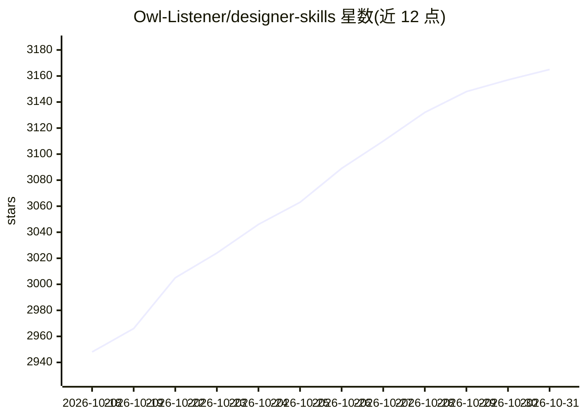

# Owl-Listener/designer-skills

⭐ 3,165 · Markdown · MIT · 推送 2026-09-05 · [GitHub](https://github.com/Owl-Listener/designer-skills) · 组织维护

**面向 AI 编码助手的设计领域技能与命令集合（273 技能/76 命令）**

为 Claude Code 与 Gemini CLI 提供的设计领域 agentic 技能包：本仓库含设计实践集合（9 插件、111 技能、34 命令），覆盖设计研究、设计系统、UX 策略、UI、交互、原型测试、设计运营等；另通过 marketplace 聚合其他四个独立仓库的集合（AI 产品设计、UX 项目管理、设计领导力、包容性设计）。技能为知识单元，命令为串联技能的完整工作流（如 discover、handoff、critique-screen）。安装方式为 Claude Code 的 /plugin marketplace add 命令，无需终端。

## 筛选速览

| 维度 | 判定 | 备注 |
|---|---|---|
| AI 角色 | `ai-knowledge` | 知识聚合/清单类 |
| 许可风险 | `permissive` | MIT |
| 部署形态 | `None` |  |
| 模型依赖 | — | README 未给出锁定关系 |
| 硬件要求 | — | 无带数字的原话,不猜 |
| 安装摩擦 | `low` | 无编译、无系统依赖或容器化 |
| 成熟度 | — | 结构信号不足 |

## 能力要点

- 273 技能与 76 命令组织为 33 个插件、五个集合
- 本仓库 9 个插件覆盖设计研究到交付全流程，含 34 个命令
- 通过 /designer-toolkit:start-here 按工作情境路由到对应命令
- 同时支持作为 Gemini CLI 扩展使用

## 适用场景

- 在 Claude Code 中运行完整的用户研究与设计发现流程
- 为 AI 助手注入设计系统、UI、交互设计领域知识
- 对现有界面执行视觉与可用性审查并输出修复清单

## 场景标签

`提示工程` · 领域:Agent 开发

## 证据(README 行号)

> L5: **273 skills and 76 commands across 33 plugins, in five collections**, for Claude Code and Gemini CLI.
> L126: ## What are skills and commands?
> L128: **Skills** are domain knowledge units — nouns. They teach Claude about a design topic: how to create a user person

## 星数曲线

2026-10-18 2,948 → 2026-10-31 3,165（+217）

---
*卡片 v1 · prompt 1.4 · 生成 2026-10-20 · 置信度 high · 依据 README sha `b9e0ba8e6feb` · [字段定义](../../DATASET.md)*
