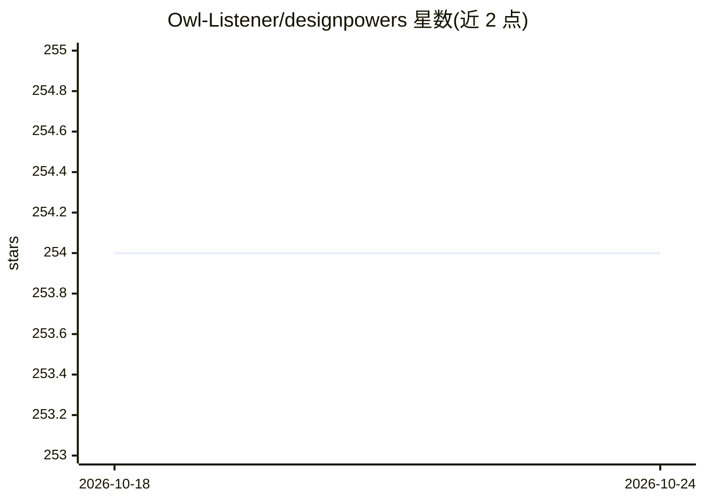

# Owl-Listener/designpowers

⭐ 254 · Shell · MIT · 推送 2026-06-23 · [GitHub](https://github.com/Owl-Listener/designpowers) · 个人维护

**由用户执导的 10 个设计 agent 团队，运行包容性设计流程**

以 markdown 文件（技能、agent、hooks）形式提供的设计 agent 团队：10 个专家 agent 覆盖发现、研究、策略、视觉设计、构建、评审与交接，内嵌无障碍（WCAG/COGA）检查于各阶段；提供 36 个技能、Build/Review 两条通道与 Direct/Auto 两种模式。系统记录跨项目的设计偏好（design memory，仅可读不用于干预）、在方向不确定时让 agent 辩论、构建中设置审美检查点。以 Claude Code 插件和 Gemini CLI 扩展分发，设计知识可被任何读取 markdown 指令的工具使用。

## 筛选速览

| 维度 | 判定 | 备注 |
|---|---|---|
| AI 角色 | `ai-native` | 本体是模型或模型工具 |
| 许可风险 | `permissive` | MIT |
| 部署形态 | `library` | 以包/库形式分发 |
| 模型依赖 | — | README 未给出锁定关系 |
| 硬件要求 | — | 无带数字的原话,不猜 |
| 安装摩擦 | `low` | 无编译、无系统依赖或容器化 |
| 成熟度 | — | 结构信号不足 |

## 能力要点

- 10 个互相交接的专家设计 agent 与 36 个技能
- 每阶段嵌入 WCAG/COGA 无障碍审查，非最后一步
- design memory 记录设计偏好但不反馈干预工作
- 支持 DESIGN.md 开放标准（Google Labs, Apache-2.0），可读写品牌 tokens

## 适用场景

- 以创意总监身份指挥 agent 团队完成从发现到交付的设计流程
- 对已有截图/URL/代码做无障碍与启发式评审
- 在 Cursor/Copilot 等编码工具中复用同一套设计流程

## 场景标签

`多智能体` `代码审查` · 领域:Agent 开发

## 证据(README 行号)

> L11: Designpowers is an open, model-agnostic design workflow that gives you a team of 10 design agents. They discover, r
> L13: **Works with any AI coding tool.** Designpowers is markdown files — skills, agents, and hooks. It ships as both a C
> L17: **10 specialist agents** that talk to each other and hand off work:

## 星数曲线

2026-10-18 254 → 2026-10-24 254（+0）

---
*卡片 v1 · prompt 1.4 · 生成 2026-10-22 · 置信度 high · 依据 README sha `df632c5acab6` · [字段定义](../../DATASET.md)*
