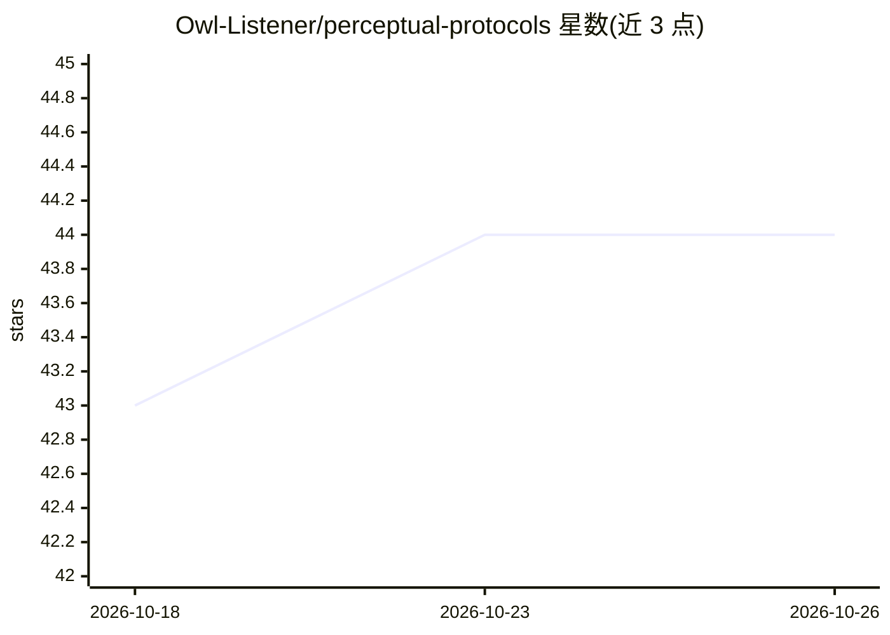

# Owl-Listener/perceptual-protocols

⭐ 44 · Python · MIT · 推送 2026-08-09 · [GitHub](https://github.com/Owl-Listener/perceptual-protocols) · 组织维护

**设计感知协议族：以 markdown 文件向 AI agent 传达设计感受**

一组单一职责的协议模板，把设计师的感性意图（氛围、静态/动态/声音/文案词汇、情境权重、token 意图等）编码为普通 markdown 文件，供 Claude、Gemini、ChatGPT、Cursor、Copilot 等任何能读文本的 agent 读取。共 9 个已发布协议（mood/vocab/motion/voice/listen/situation/tokens/trace/critique），可组合为完整工作流；安装方式为手工复制文件或运行 POSIX shell 脚本 install.sh，无构建步骤、无 schema、无 API key，模型无关。含一个 Planned 状态的 taste-protocol。

## 筛选速览

| 维度 | 判定 | 备注 |
|---|---|---|
| AI 角色 | `ai-ecosystem` | LLM/agent 周边工具 |
| 许可风险 | `permissive` | MIT |
| 部署形态 | `None` |  |
| 模型依赖 | — | README 未给出锁定关系 |
| 硬件要求 | — | 无带数字的原话,不猜 |
| 安装摩擦 | `low` | 无编译、无系统依赖或容器化 |
| 成熟度 | — | 结构信号不足 |

## 能力要点

- 9 个已发布协议各做一事，输出可组合的 markdown 文件
- mood-protocol：从 moodboard 截图经视觉模型生成 mood.md
- 模型无关：任何能读文本的 agent 均可使用
- install.sh 复制文件、不联网、不覆盖，手工复制为规范路径

## 适用场景

- 让 AI 编码 agent 在动工前了解产品应有的视觉/动效/声音/文案感受
- 为已有设计系统的 token 补充设计意图标注
- 对 agent 产出按 brief 进行 critique 校验

## 场景标签

`提示工程` · 领域:Agent 开发

## 证据(README 行号)

> L13: Each protocol does one thing and stops. Each one outputs a plain markdown file that any agent — Claude, Gemini, Cha
> L75: Then point your agent at them: add them to `CLAUDE.md`, your Cursor rules, your system prompt, or just say *"read m
> L83: **Markdown, always.** The output is plain `.md`. Portable, versionable, agent-readable, human-readable. No propriet

## 星数曲线

2026-10-18 43 → 2026-10-26 44（+1）

---
*卡片 v1 · prompt 1.4 · 生成 2026-10-25 · 置信度 high · 依据 README sha `38264173ab11` · [字段定义](../../DATASET.md)*
